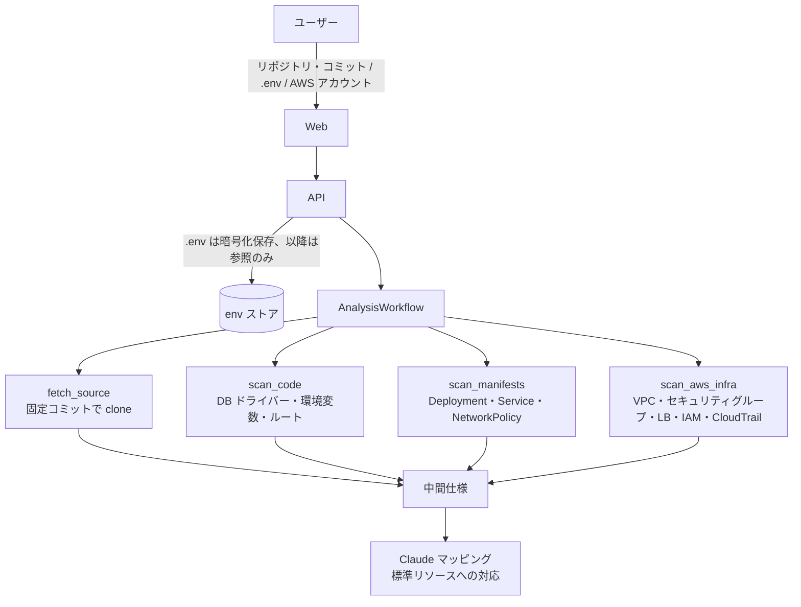
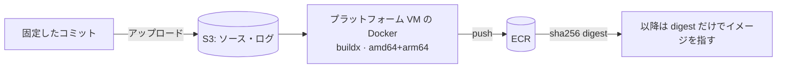
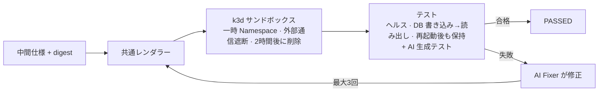
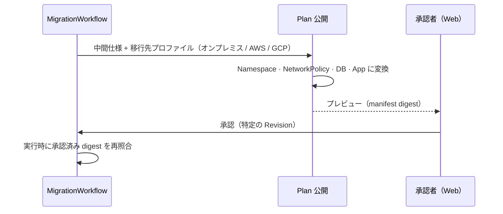
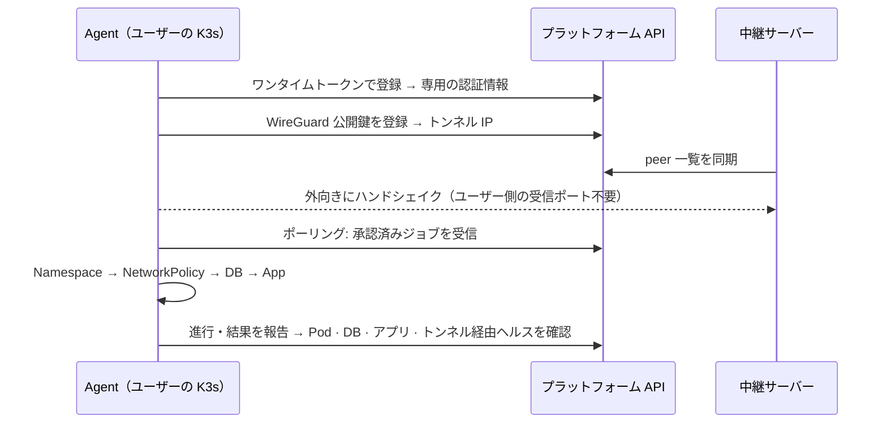
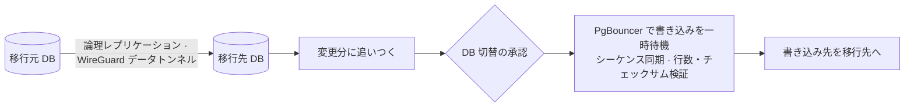
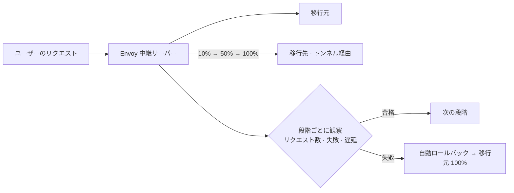
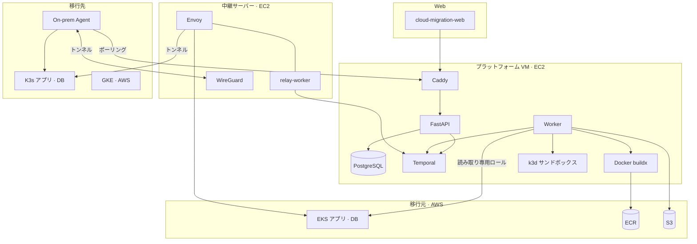

<p align="center"><a href="README.md">English</a> · <b>日本語</b> · <a href="README.ko.md">한국어</a></p>

<div align="center">

# Cloud Migration Platform

AWS EKS で動いているアプリと PostgreSQL を、オンプレミスの K3s や別のクラウドへ移行するプラットフォームです。


</div>

## リポジトリ一覧

この README は `cloud-migration-platform` の説明です。チームのリポジトリは次のとおりです。

| リポジトリ | 役割 |
| --- | --- |
| [cloud-migration-platform](https://github.com/SoftBank-Hackathon-2026-Team-Jackal/cloud-migration-platform) | バックエンド：FastAPI API、Temporal Worker、移行ロジック（このリポジトリ） |
| [cloud-migration-web](https://github.com/SoftBank-Hackathon-2026-Team-Jackal/cloud-migration-web) | Web 画面（TypeScript）。既定ではモックデータで動き、SSE モードではプラットフォームのイベントで動きます |
| [demo-app](https://github.com/SoftBank-Hackathon-2026-Team-Jackal/demo-app) | デモで使う移行対象アプリ：メッセージごとにどの環境と DB が処理したかを残す Go のチャットアプリ |
| [demo-app-vuln](https://github.com/SoftBank-Hackathon-2026-Team-Jackal/demo-app-vuln) | `demo-app` に SQL インジェクションの脆弱性を 3 つ入れた版。Sandbox レッドチームの確認用 |
| [demo-application](https://github.com/SoftBank-Hackathon-2026-Team-Jackal/demo-application) | 以前のデモ対象アプリ（Python）。現在は `demo-app` に置き換えました |
| [Softbank-Hackathon-2026-Finals](https://github.com/SoftBank-Hackathon-2026-Team-Jackal/Softbank-Hackathon-2026-Finals) | 決勝の記録、PoC、クラウド設定（Terraform） |
| [.github](https://github.com/SoftBank-Hackathon-2026-Team-Jackal/.github) | Organization のプロフィール |

<!-- TODO: Web E2E の録画（GIF または mp4） -->

## 概要

ユーザーは Web 画面で GitHub リポジトリ、`.env` ファイル、AWS アカウントを接続し、移行する範囲を選びます。その後はプラットフォームが進めます。

1. ソースコード、EKS のマニフェスト、AWS リソースを読み、アプリが何を使っているかを整理します。
2. イメージをビルドし、隔離されたサンドボックスで動かしてテストします。テストが失敗すると AI（Claude）が原因を直し、もう一度テストします。
3. 移行先に合わせたデプロイ計画を作り、人が承認したらデプロイします。オンプレミスの場合は、ユーザーのクラスターに入れた Agent がデプロイします。
4. DB は論理レプリケーションで移したあと、短時間だけ書き込みを止めて切り替えます。トラフィックは段階的に移します。

移行の途中で移行元のセキュリティ設定が抜け落ちないことを重視しました。移行元のセキュリティグループとマニフェストからコンポーネント間の接続関係を取り出し、移行先では既定で遮断し必要な経路だけを開ける NetworkPolicy として作り直します。

## 実行の流れ

<p align="center">
  
</p>

移行1件は [Temporal](https://temporal.io) のワークフロー `MigrationWorkflow` 1つとして実行されます。承認待ちのように時間のかかる段階があり、その間にサーバーが再起動することもあるため Temporal を選びました。ワークフローは履歴をもとに、止まったところから再開します。

| 構成要素 | このリポジトリでは |
| --- | --- |
| Workflow | `MigrationWorkflow` が分析、サンドボックス、承認、データ、トラフィックの各段階を子ワークフローとして順に実行 |
| Activity | git clone、AWS の参照、buildx、kubectl・Helm、DB 操作など外部とやり取りする処理。失敗すると自動で再試行 |
| Worker | プラットフォーム VM の `worker` コンテナが 6 つのタスクキューを、中継サーバーの `relay-worker` が `relay-1` を処理 |
| Signal · Query | 承認（`approve`）、DB 切替（`switchover`）、トラフィックのロールバック・再試行 / 状態参照（`status`） |

各段階の進行イベント（`analysis.*`、`sandbox.*`、`plan.*`、`provision.*`、`data.*`、`traffic.*`、`cutover.*`）は保存され、Web は `GET /migrations/{id}/events`（SSE）で受け取って画面に表示します。

## 各段階の説明

<details open>
<summary><b>1. 接続と分析</b></summary>



- AWS アカウントは CloudFormation で作成した読み取り専用ロールで接続します。移行範囲は EKS の Namespace とワークロード単位で選びます。
- `.env` は暗号化して保存し、分析ではキー名だけを見ます。
- 分析結果（中間仕様）には、アプリが使う DB、設定、外部公開、接続関係と、それぞれをプラットフォームの標準リソースにどう置き換えるかが入ります。

</details>

<details>
<summary><b>2. イメージビルド</b></summary>



- プラットフォーム VM の Docker で buildx を使って amd64・arm64 のイメージをビルドし、ECR に push します。ビルド中はインスタンスメタデータへのアクセスを遮断し、ユーザーのコードがプラットフォームの認証情報を読めないようにしています。
- 以降の段階はタグではなくイメージの digest を使います。サンドボックスでテストしたイメージがそのままデプロイされます。

</details>

<details>
<summary><b>3. サンドボックス検証</b></summary>



- プラットフォーム VM 上の k3d クラスターに、実行ごとに一時的な Namespace を作り、外向きの通信を遮断します。2 時間たつと削除します。
- 標準テストはヘルスチェック、DB への書き込みと読み出し、再起動後のデータ保持です。これに AI が作ったテストが加わります。
- 失敗すると Fixer が修正し、再度レンダリングしてテストします。最大 3 回まで試します。
- サンドボックスと実際のデプロイは同じレンダラー（`shared_deployment_v2`）を使います。

</details>

<details>
<summary><b>4. デプロイ計画と承認</b></summary>



- 移行先のプロファイル（オンプレミス、AWS、GCP）に合わせて Namespace、NetworkPolicy、DB、アプリの構成を作り、Revision として保存します。
- 承認は Revision 単位です。デプロイ時のイメージ digest が承認時と異なる場合は `ARTIFACT_DIGEST_MISMATCH` で中止します。

</details>

<details>
<summary><b>5. オンプレミスへのデプロイ</b></summary>



- ユーザーは Agent の Helm チャートを一度インストールするだけです。Agent はワンタイムトークンで登録し、プラットフォームへの外向き接続だけを行います。
- WireGuard トンネルも Agent から中継サーバーへ接続するため、ユーザーのネットワークでポートを開ける必要はありません。
- Agent は承認済みのジョブをポーリングで受け取り、Namespace、NetworkPolicy、DB、アプリの順にデプロイして結果を報告します。失敗した場合は直前の Revision に戻します。

</details>

<details>
<summary><b>6. データ複製と DB 切替</b></summary>



- スキーマと初期データをコピーしたあと、論理レプリケーションで変更分に追いつきます。
- DB の切り替えは 2 回目の承認のあとに行います。PgBouncer で書き込みを一時停止し、シーケンスを合わせ、行数とチェックサムを比較してから移行先 DB に切り替えます。
- EKS から GKE への検証では、書き込みの停止は 83ms で、行数とチェックサムは一致しました。

</details>

<details>
<summary><b>7. トラフィック切替</b></summary>



- 中継サーバーの Envoy の重みを 10%、50%、100% の順に変えます。各段階でリクエスト数、失敗、遅延を見て、基準を超えたら移行元に戻します。
- Web からロールバックや再試行を実行することもできます。

</details>

## アーキテクチャ



## 使用しているクラウドサービス

| クラウド | サービス | 用途 |
| --- | --- | --- |
| AWS | EC2、SSM、CloudFormation | プラットフォームと中継サーバーの運用、デプロイ、接続ロールのテンプレート |
| AWS | EKS、IAM（ロール・アクセスエントリ）、CloudTrail、VPC | 移行元の分析（読み取り専用）、データ移行用の別ロール |
| AWS | ECR、S3 | ビルドしたイメージ、ソースとビルドログ |
| Google Cloud | GKE、Terraform | クラウドへのデプロイ、データ移行の検証 |
| オンプレミス | K3s、Helm、WireGuard | Agent のデプロイ、トンネル |

## AI の利用範囲

AI には Claude を使っています。使っているのは次の 3 か所です。

- 分析：移行元の構成をプラットフォームの標準リソースに対応付けます。判断ごとに根拠（ファイルと行番号）を残し、人が計画のプレビューで確認します。
- サンドボックス：テストを作り、失敗したテストの原因を直します。外向きの通信を遮断したサンドボックスの中だけで動きます。
- コストとデータ：移行 1 件あたり $5、1 日 $20、1 か月 $100 の上限をコードで適用しています。モデルにはマスクした根拠の一部だけを送り、`.env` の値やコード全体は送りません。詳しくは [ADR-004](docs/decisions/ADR-004.md) を参照してください。

## 実装状況

デモサーバーで実際に動いている範囲です。

| 段階 | 状態 |
| --- | --- |
| 接続・範囲選択、分析、イメージビルド、サンドボックス検証 | 動作 |
| デプロイ計画・承認、オンプレミスへのデプロイ（Agent・トンネル） | 動作。ユーザーの K3s へのアプリと DB のデプロイまで確認 |
| トラフィック切替 | 検証中。実際の実行で段階的な切替の開始まで確認 |
| データ複製・DB 切替 | EKS→GKE は検証済み。オンプレミスの経路は実装中（[ADR-007](docs/decisions/ADR-007.md)） |

## 主な設計判断

- Temporal を選んだ理由と、実行中のワークフローを保ったままコードを変更する方法：[ADR-001](docs/decisions/ADR-001.md)
- サンドボックスで検証したイメージ digest を本番のデプロイにそのまま使う方式：[ADR-003](docs/decisions/ADR-003.md)
- 移行元・移行先環境の接続方式（AWS のロール委任、GCP の固定プロジェクト）：[ADR-005](docs/decisions/ADR-005.md)
- トラフィック切替を Envoy の中継で行う理由：[ADR-006](docs/decisions/ADR-006.md)
- オンプレミスのデータ移行経路を移行元側のゲートウェイにした理由：[ADR-007](docs/decisions/ADR-007.md)
- プラットフォームを FastAPI API と Temporal Worker で構成した理由：[ADR-009](docs/decisions/ADR-009.md)
- データを PostgreSQL の論理レプリケーションで移し、移行元側の PgBouncer で切り替える理由：[ADR-010](docs/decisions/ADR-010.md)
- Worker が `kubectl exec` で SQL を実行し、EKS トークンを Activity 間で再利用する理由：[ADR-011](docs/decisions/ADR-011.md)
- 切替時に移行元アプリの NetworkPolicy へ許可ルールだけを追加する理由：[ADR-012](docs/decisions/ADR-012.md)
- DB 切替の承認前にシャドーリハーサルで移行先の応答を観察する理由：[ADR-013](docs/decisions/ADR-013.md)
- デモ用プラットフォームを単一の EC2 で運用し、main のコミットだけをデプロイする方式：[ADR-014](docs/decisions/ADR-014.md)

秘密情報はリポジトリ、イベント、ログに残しません。`.env` は暗号化して保存し以降は参照だけを渡します。Agent と承認者のトークンは DB にハッシュだけを保存します。

## 開発の進め方

- 判断は `docs/decisions/` の ADR 7 件と領域ごとの仕様（`specs/`）に残しました。作業は `tickets/` のチケット 136 件に分け、検討した代替案、選んだ理由、確認結果を一緒に書きました。
- 変更はすべて PR で出し、CI（ruff、pytest 約 3,000 件）を通してから squash マージしました。これまでにマージした PR は約 160 件です。
- 分析・検証、Provisioning、データ移行、トラフィック、Web で担当を分け、領域間のインターフェースは `packages/contracts` とイベントスキーマで合わせました。

## リポジトリ構成

| パス | 内容 |
| --- | --- |
| `apps/api` | FastAPI。移行の開始・参照・承認、接続、Agent・トンネル、イベント（SSE）、レポート |
| `apps/worker` | Temporal の Workflow、Activity、Worker |
| `packages/contracts` | イベント、タスクキュー、入力モデルの定義 |
| `packages/scanners` | コード、マニフェスト、AWS の分析 |
| `packages/agents` | AI マッピング、テスト生成、Fixer |
| `packages/testsuite` | サンドボックスのテスト実行 |
| `packages/providers` | レンダラー、NetworkPolicy、移行先ごとのデプロイ、オンプレミス Agent・トンネル |
| `packages/data` | データ複製、DB 切替 |
| `packages/traffic` | Envoy の設定、トラフィック切替 |
| `infra/` | デモサーバー、Agent の Helm チャート、中継サーバー、接続テンプレート、Terraform |
| `docs/`、`specs/`、`tickets/` | 設計判断、仕様、作業記録 |

## ローカルでの実行

Python 3.11、[uv](https://docs.astral.sh/uv/)、Docker Compose が必要です。詳しい実行方法、Agent の登録、ファイルごとの役割は[開発ガイド](docs/development.md)（韓国語）を参照してください。

```bash
cp .env.example .env
make setup
make infra-up    # PostgreSQL, Temporal
make workers     # 別のターミナルで
make api         # 別のターミナルで。http://localhost:8000/docs
```

## ドキュメント

設計ドキュメントの多くは韓国語で書かれています。

- [開発ガイド](docs/development.md)
- [設計判断（ADR）](docs/decisions/)
- [Temporal ガイド](docs/architecture/temporal-flow.md)
- [イベントガイド](docs/engineering/events-guide.md)
- [`.env` 参照ガイド](docs/engineering/env-file-guide.md)
- [オンプレミス Agent の導入と運用](specs/provisioning/onprem-agent-install.md)
- [デモサーバーの運用](infra/demo/README.md)

<!-- TODO: チーム紹介 -->
