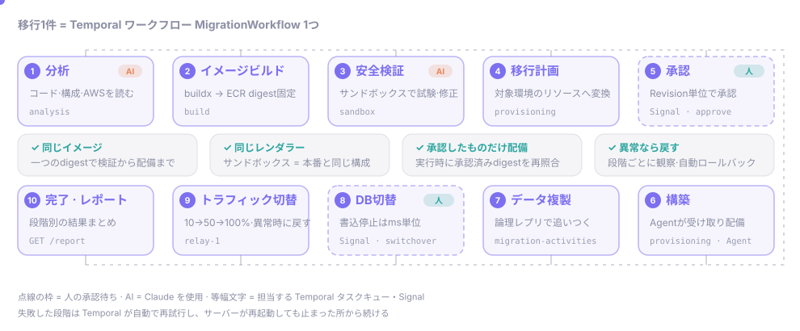
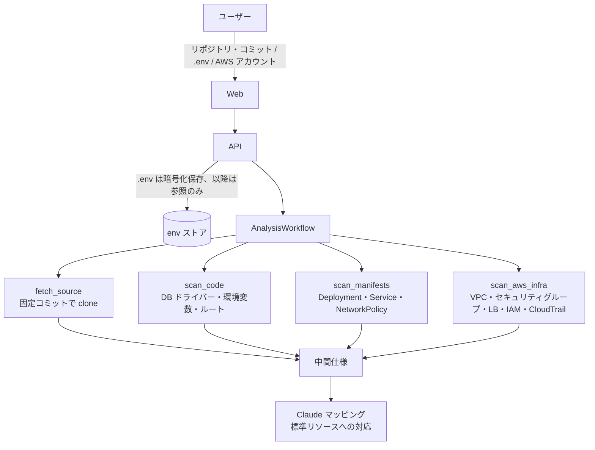
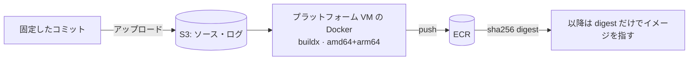
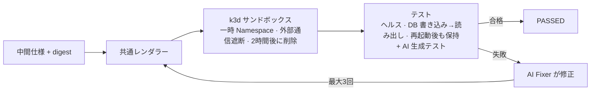
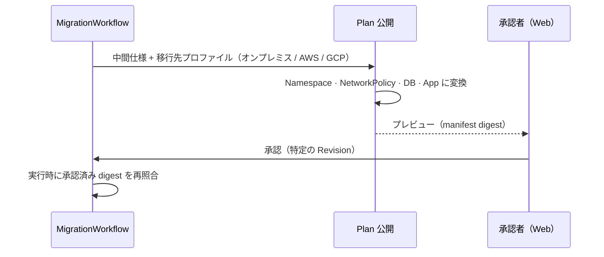
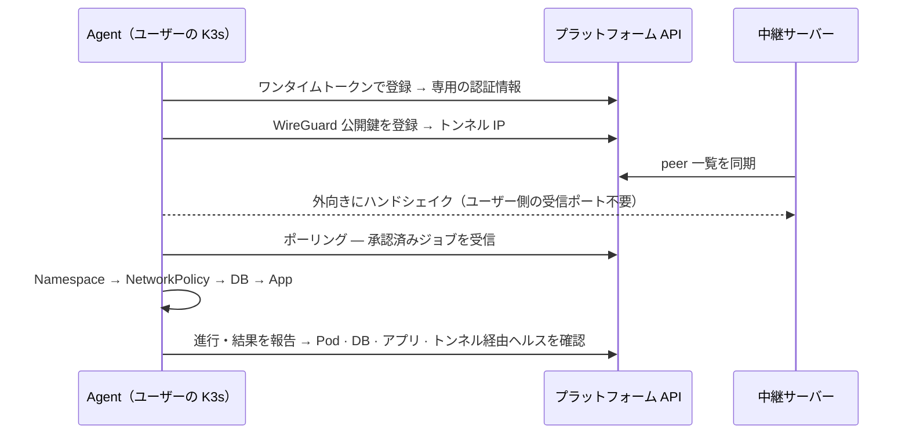
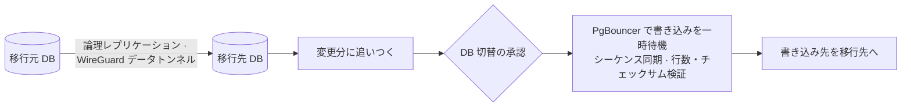
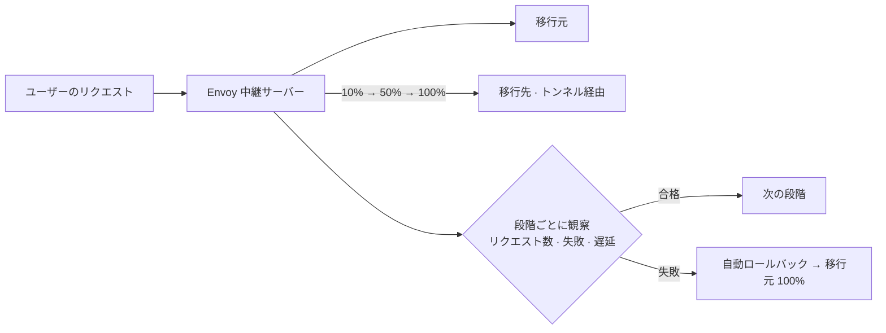
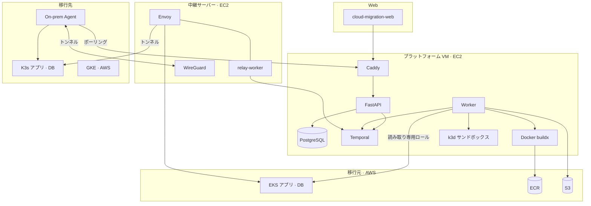

<div align="center">

<p align="center"><a href="README.md">English</a> · <b>日本語</b> · <a href="README.ko.md">한국어</a></p>

# Cloud Migration Platform

### 稼働中の EKS アプリと DB を、止めずに、同じセキュリティ水準のまま移行する

オンプレミス（K3s）や別のクラウドへ — AI が分析し、まずサンドボックスで動かして直し、人が承認した構成だけを配備します。


</div>

<!-- TODO: Web E2E の録画（GIF、または GitHub エディタにドロップした mp4） -->
<p align="center"><i>デモ録画の場所 — Web で移行1件が分析からトラフィック切替まで進む様子</i></p>

---

## ひと目で

| 課題が問いかけたこと | 私たちの答え |
| --- | --- |
| 稼働中のアプリを**止めずに**別の環境へ移せるか？ | DB は論理レプリケーションで追いついた後、切替時の書き込み停止をミリ秒単位に抑えます。トラフィックは 10→50→100% と段階的に移し、異常があれば自動で戻します |
| セキュリティとガバナンスを**すべての環境で同じ水準**に保てるか？ | 移行元のセキュリティグループとマニフェストから「誰が誰に接続するか」を抽出し、移行先では NetworkPolicy として作り直します。既定はすべて遮断し、使っていた経路だけを開けます |
| オンプレミスで、**クラウドでは当たり前だった機能**をどう再現するか？ | ユーザーのクラスターにいる Agent が外向きの接続だけ（ポーリング + WireGuard）で配備するため、受信ポートを開ける必要がありません。LB やマネージド DB は標準構成に置き換えます |
| 点検と修正を **AI にどこまで安全に**任せられるか？ | AI は外部通信を遮断したサンドボックスの中だけで試験・修正します。本番には人が承認した Revision だけを配備し、実行時に承認済みのイメージ・構成 digest を再照合します |

## なぜ作ったのか

クラウドで問題なく動いていたアプリは、移した瞬間に**静かに弱くなります**。セキュリティグループが消え、マネージド DB とロードバランサーがなくなり、どのポートを開けておくべきだったか誰も覚えていません。そのため移行は人が一つずつ合わせ、サービスを止めて移すことが多いのです。

私たちはこれを **分析 → 検証 → 承認 → 実行** の一つの流れにまとめました。人は判断だけを行い、確かめられることはすべてプラットフォームが確かめます。

---

## 全体の流れ

<p align="center">
  
</p>

移行1件は [Temporal](https://temporal.io) のワークフロー `MigrationWorkflow` 1つです。何日かかっても、サーバーが再起動しても、人の承認を待つ間も、状態を失わず止まった所から続けます。

| 構成要素 | このプラットフォームでは |
| --- | --- |
| **Workflow** — 順序と待機 | `MigrationWorkflow` が子 Workflow（分析・サンドボックス・承認・データ・トラフィック）を順に呼びます。再起動しても履歴をたどり直して続けます |
| **Activity** — 外部との実作業 | clone、AWS 参照、buildx、kubectl・Helm、DB 書き込み。失敗すると自動で再試行されるため、2回実行しても結果が同じになるよう作ります |
| **Worker** — キューをポーリングして実行 | プラットフォーム VM の `worker` が6つのキューを、中継サーバーの `relay-worker` が `relay-1` を担当します |
| **Signal · Query** — 人とのつながり | 承認 `approve`、DB 切替 `switchover`、ロールバック・再試行 / 状態参照 `status` |

各段階は進行イベント（`analysis.*` `sandbox.*` `plan.*` `provision.*` `data.*` `traffic.*` `cutover.*`）を残し、Web は `GET /migrations/{id}/events`（SSE）でリアルタイムに受け取ります。

---

## 機能ごとの流れ

<details open>
<summary><b>① 接続と分析</b> — 何を移すべきかを把握する</summary>



- AWS アカウントは CloudFormation で作る**読み取り専用ロール**で接続し、移行範囲は EKS の Namespace・ワークロード単位で選びます。
- `.env` の値は一度だけ暗号化して保存し、分析は**キー名だけ**を読みます。
- 結果は、アプリが使うもの（DB、設定、公開、接続関係）と、それが標準リソースにどう対応するか（そのまま / 変更が必要）を表す**中間仕様**です。

</details>

<details>
<summary><b>② イメージビルド</b> — 同じソースを同じイメージに固定する</summary>



- ビルド中はインスタンスメタデータ（認証情報）に届かないよう遮断し、ユーザーのコードがプラットフォームの権限を奪えないようにします。
- サンドボックスと本番が**同じ digest** を使うため、検証したイメージと配備されるイメージは同じです。

</details>

<details>
<summary><b>③ サンドボックス検証</b> — AI がまず動かして直す</summary>



- サンドボックスと本番は**同じレンダラー**（`shared_deployment_v2`）を使います。
- AI はこの隔離された場所でだけ自由に修正し、修正後は再びテストに合格しなければ先へ進めません。

</details>

<details>
<summary><b>④ 移行計画と承認</b> — 移行先に合わせた Plan を人が承認する</summary>



- 接続の意図から作る **NetworkPolicy**：既定はすべて遮断し、アプリ→DB など移行元で使っていた経路だけを開けます。
- 承認は特定の Revision に対してだけ有効で、実行時に digest が異なれば（`ARTIFACT_DIGEST_MISMATCH`）配備しません。

</details>

<details>
<summary><b>⑤ オンプレミス構築</b> — ポートを開けずにユーザーのクラスターへ配備する</summary>



- ユーザーは Agent の Helm チャートを**一度インストールする**だけです。失敗すると直前の Revision に戻します。

</details>

<details>
<summary><b>⑥ データ複製と DB 切替</b> — 書き込みをほとんど止めない</summary>



- クラウド間（EKS→GKE）の検証：書き込み停止 **83ms**、行数・チェックサム一致、アプリの書き込みエラー 0 件。

</details>

<details>
<summary><b>⑦ トラフィック切替</b> — 段階的に移し、異常なら戻す</summary>



</details>

---

## アーキテクチャ



## 使っているクラウド

| クラウド | サービス | 用途 |
| --- | --- | --- |
| AWS | EC2 · SSM · CloudFormation | プラットフォームと中継サーバーの運用、SSH なしの配備、接続ロールのテンプレート |
| AWS | EKS · IAM ロール・アクセスエントリ · CloudTrail · VPC | 移行元の読み取り専用分析、データ移行用に権限を絞った別ロール |
| AWS | ECR · S3 | digest で固定したイメージ、ソースとログの保管 |
| Google Cloud | GKE · Terraform | クラウドの移行先、クラウド間データ移行の検証 |
| オンプレミス | K3s · Helm · WireGuard | Agent の配備、外向きだけのトンネル |

## AI を使う場所と安全装置

| どこで | 何を | 安全装置 |
| --- | --- | --- |
| 分析 | 移行元の構成を標準リソースに対応付ける | 判断ごとに根拠（ファイル:行）を残し、Plan プレビューで人が確認 |
| サンドボックス | テスト生成、失敗の修正（Fixer） | 外部通信を遮断した一時的な場所だけで実施し、修正後は再テスト合格が必須 |
| 共通 | Claude 呼び出し | コードで強制するコスト上限（移行1件 $3 · 1日 $20 · 1か月 $100）と使用量台帳。モデルにはマスクした根拠の断片だけを送り、`.env` の値やコード全体は送らない（[ADR-004](docs/decisions/ADR-004.md)） |

## どこまで動くか

> デモで見せるのはモックではなく、デモサーバーで実際に動く流れです。進行中の部分はそう明記しています。

| 段階 | 状態 |
| --- | --- |
| 接続・範囲選択、分析、イメージビルド、サンドボックス検証 | ✅ デモサーバーで実際に動作 |
| 計画・承認、オンプレミス構築（Agent・トンネル） | ✅ 実際に動作 — ユーザーの K3s にアプリと DB を配備し、4つの確認に合格 |
| トラフィック切替 | 🟡 実行で検証中 — 段階的な重み切替への進入を確認 |
| データ複製・DB 切替 | 🟡 クラウド間（EKS→GKE）で検証済み · オンプレミス経路は実装中（[ADR-007](docs/decisions/ADR-007.md)） |

## 技術的に工夫したこと

- **長い処理を失わない** — 数時間かかる承認待ちやサーバー再起動に耐えるため Temporal を選び、移行の実行中にコードを変えるときは patch マーカーで新旧の実行を分けました（[ADR-001](docs/decisions/ADR-001.md)）。
- **検証したものだけを配備する** — サンドボックスと本番が同じイメージ digest と同じレンダラーを使い、実行時に承認済み digest を再照合します（[ADR-003](docs/decisions/ADR-003.md)）。
- **ユーザー側に穴を開けない** — オンプレミス Agent とトンネルはユーザー側から外向きにだけ接続します。データトンネルの向きも同じ原則で決めました（[ADR-007](docs/decisions/ADR-007.md)）。
- **秘密情報を漏らさない** — `.env` は暗号化保存して以降は参照だけを渡し、Agent・承認者のトークンは DB に digest だけを残します。
- **権限を分ける** — 移行元の接続は読み取り専用ロール、データ移行は2つの Namespace に絞った別ロールを使います。

## チーム開発のやり方

- 判断は **ADR 7件**と領域ごとの仕様（`specs/`）に残し、作業は **チケット136件**（`tickets/`）に分けて、代替案・選んだ理由・確認結果を記録しました。
- すべての変更はブランチ → PR → CI（ruff、pytest **約3,000件**）→ squash マージで取り込み、マージ済み PR は約160件です。
- 領域（分析・検証 / Provisioning / データ移行 / トラフィック / Web）ごとに担当を置き、互いの約束は `packages/contracts` とイベントスキーマで合わせました。

---

## リポジトリ構成

| パス | 役割 |
| --- | --- |
| `apps/api` | FastAPI — 移行の開始・参照・承認、接続、Agent・トンネル、イベント（SSE）、レポート |
| `apps/worker` | Temporal Workflow · Activity · Worker |
| `packages/contracts` | 契約 — イベント、タスクキュー、入力モデル |
| `packages/scanners` | コード · マニフェスト · AWS 分析 |
| `packages/agents` | AI マッピング · テスト生成 · Fixer |
| `packages/testsuite` | サンドボックスのテスト実行 |
| `packages/providers` | レンダラー、NetworkPolicy、移行先ごとの構築、オンプレミス Agent・トンネル |
| `packages/data` | データ複製 · DB 切替 |
| `packages/traffic` | Envoy 設定 · トラフィック切替 |
| `infra/` | デモサーバー、Agent の Helm チャート、中継サーバー、接続テンプレート、Terraform |
| `docs/` · `specs/` · `tickets/` | 設計判断、仕様、作業記録 |

## はじめかた

必要なツール：Python 3.11、[uv](https://docs.astral.sh/uv/)、Docker Compose。ローカル実行・Agent 登録・ファイルごとの役割の詳細は[開発ガイド](docs/development.md)（韓国語）にあります。

```bash
cp .env.example .env
make setup
make infra-up    # PostgreSQL, Temporal
make workers     # 別のターミナルで
make api         # 別のターミナルで → http://localhost:8000/docs
```

## さらに読む

設計文書の多くは韓国語で書かれています。

[開発ガイド](docs/development.md) · [設計判断（ADR）](docs/decisions/) · [Temporal ガイド](docs/architecture/temporal-flow.md) · [イベントガイド](docs/engineering/events-guide.md) · [`.env` 参照ガイド](docs/engineering/env-file-guide.md) · [オンプレミス Agent の導入・運用](specs/provisioning/onprem-agent-install.md) · [デモサーバー運用](infra/demo/README.md)

<!-- TODO: チーム紹介 -->
