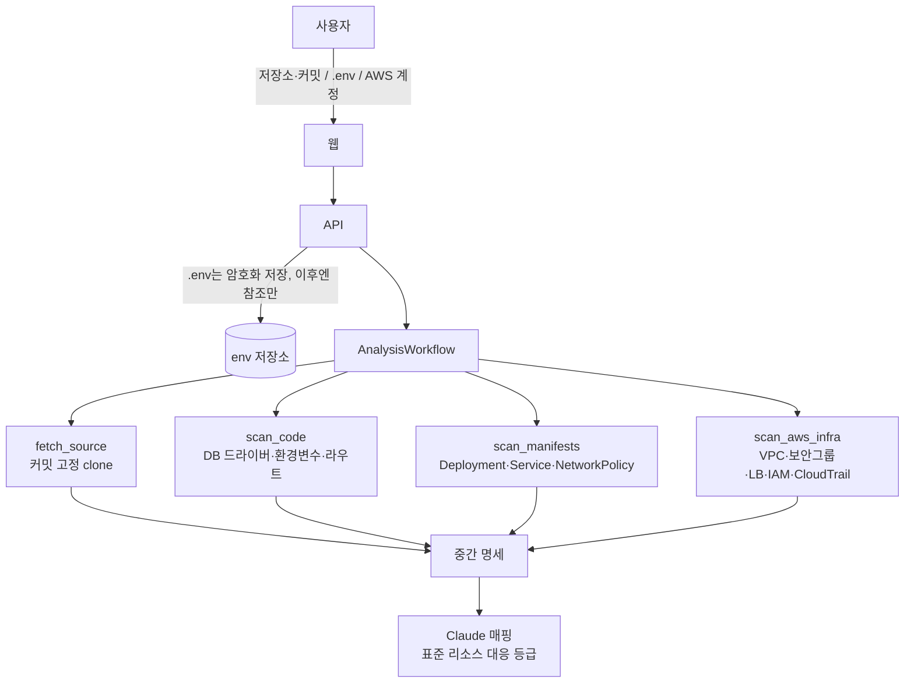
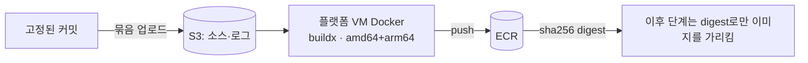
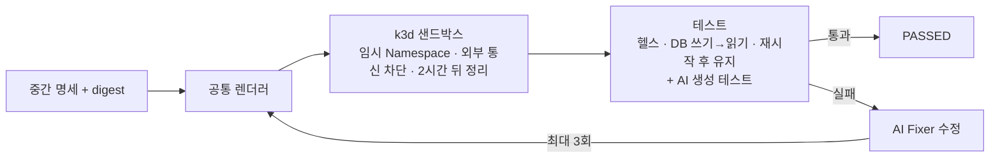
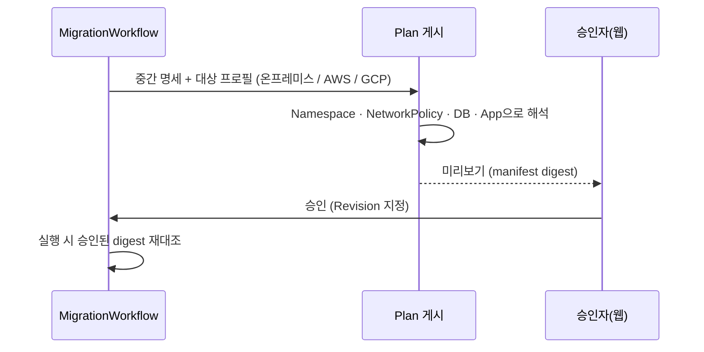
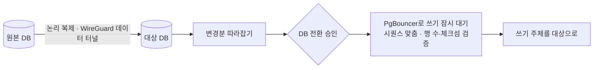
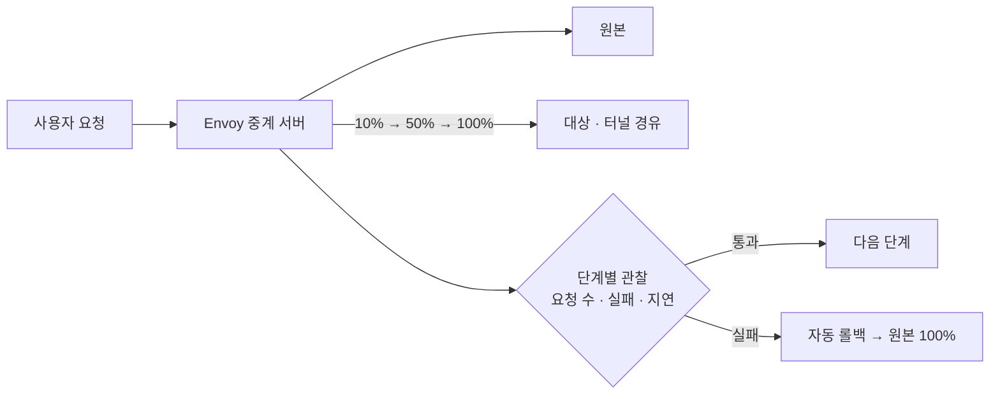
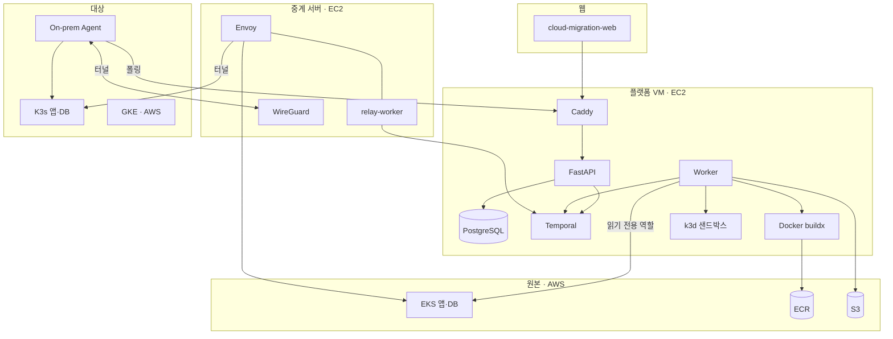

<div align="center">

<p align="center"><a href="README.md">English</a> · <a href="README.ja.md">日本語</a> · <b>한국어</b></p>


# Cloud Migration Platform

### 돌고 있는 EKS 앱과 DB를, 멈추지 않고 같은 보안 수준으로 옮긴다

온프레미스(K3s)·다른 클라우드로 — AI가 분석하고 샌드박스에서 먼저 띄워 고친 뒤, 사람이 승인한 구성만 배포합니다.


</div>

<!-- TODO: 웹 E2E 녹화 (GIF, 또는 GitHub 편집기에 끌어다 놓은 mp4) -->
<p align="center"><i>데모 녹화 자리 — 웹에서 이전 한 건이 분석부터 트래픽 전환까지 진행되는 모습</i></p>

---

## 한눈에 보기

| 대회가 던진 질문 | 우리의 답 |
| --- | --- |
| 가동 중인 앱을 **멈추지 않고** 다른 환경으로 옮길 수 있는가? | DB는 논리 복제로 따라잡은 뒤 쓰기를 ms 단위로만 멈추고 전환하고, 트래픽은 10→50→100%로 나눠 옮기며 이상하면 자동으로 되돌립니다 |
| 보안·거버넌스를 **모든 환경에서 같은 수준**으로 지킬 수 있는가? | 원본의 보안그룹·매니페스트에서 "누가 누구에게 접속하는가"를 뽑아, 대상 환경에서 기본 차단 + 필요한 길만 여는 NetworkPolicy로 다시 만듭니다 |
| 온프레미스로 갈 때 **클라우드에서 당연하던 기능**을 어떻게 재현하는가? | 사용자 클러스터의 Agent가 포트 개방 없이 밖으로만 접속(폴링 + WireGuard)해 배포하고, LB·관리형 DB 대신 표준 구성으로 바꿔 놓습니다 |
| 점검과 수정을 **AI에게 어디까지 안전하게** 맡길 수 있는가? | AI는 외부 통신이 막힌 샌드박스에서만 테스트하고 고칩니다. 실제 환경에는 사람이 승인한 Revision만 배포하고, 실행할 때 승인된 이미지·구성 digest를 다시 대조합니다 |

## 왜 만들었나

클라우드에서 잘 돌던 앱은 다른 곳으로 옮기는 순간 **조용히 약해집니다.** 보안그룹이 사라지고, 관리형 DB와 로드밸런서가 없어지고, 어떤 포트가 열려 있어야 하는지 아무도 기억하지 못합니다. 그래서 이전은 사람이 손으로 하나씩 맞추고, 서비스를 멈춘 채 옮기는 경우가 많습니다.

우리는 이 과정을 **분석 → 검증 → 승인 → 실행**의 한 흐름으로 묶었습니다. 사람은 결정만 하고, 확인할 수 있는 것은 플랫폼이 모두 확인합니다.

---

## 전체 흐름

<p align="center">
  
</p>

이전 한 건은 [Temporal](https://temporal.io) 워크플로우 `MigrationWorkflow` 하나입니다. 며칠이 걸려도, 서버가 재시작돼도, 사람의 승인을 기다리는 동안에도 상태를 잃지 않고 멈춘 곳부터 이어갑니다.

| 구성 요소 | 우리 플랫폼에서 |
| --- | --- |
| **Workflow** — 순서와 기다림 | `MigrationWorkflow`가 자식 Workflow(분석 · 샌드박스 · 승인 · 데이터 · 트래픽)를 차례로 부른다. 재시작돼도 이력을 다시 따라가 이어간다 |
| **Activity** — 바깥과 실제로 일함 | clone, AWS 조회, buildx, kubectl·Helm, DB 쓰기. 실패하면 자동 재시도하므로 두 번 실행돼도 결과가 같게 만든다 |
| **Worker** — 큐를 폴링해 실행 | 플랫폼 VM의 `worker`가 큐 6개를, 중계 서버의 `relay-worker`가 `relay-1`을 맡는다 |
| **Signal · Query** — 사람과 연결 | 승인 `approve`, DB 전환 `switchover`, 롤백·재시도 / 상태 조회 `status` |

모든 단계는 진행 이벤트(`analysis.*` `sandbox.*` `plan.*` `provision.*` `data.*` `traffic.*` `cutover.*`)를 남기고, 웹은 `GET /migrations/{id}/events`(SSE)로 실시간으로 받습니다.

---

## 기능별 흐름

<details open>
<summary><b>① 연결과 분석</b> — 무엇을 옮겨야 하는지 알아낸다</summary>



- AWS 계정은 CloudFormation으로 만든 **읽기 전용 역할**로 연결하고, 옮길 범위는 EKS의 Namespace·워크로드 단위로 고릅니다.
- `.env` 값은 한 번만 암호화해 저장하고, 분석은 **키 이름만** 읽습니다.
- 결과는 앱이 쓰는 것(DB, 설정, 노출, 접속 관계)과 그것이 우리 표준 리소스에 어떻게 대응하는지(그대로 / 바꿔야 함)를 담은 **중간 명세**입니다.

</details>

<details>
<summary><b>② 이미지 빌드</b> — 같은 소스를 같은 이미지로 고정한다</summary>



- 빌드 중에는 인스턴스 메타데이터(자격 증명)에 닿지 못하게 막습니다. 사용자 코드가 플랫폼 권한을 훔칠 수 없습니다.
- 샌드박스와 실제 구축이 **같은 digest**를 쓰므로, 검증한 이미지와 배포되는 이미지가 같습니다.

</details>

<details>
<summary><b>③ 샌드박스 검증</b> — AI가 먼저 띄워 보고 고친다</summary>



- 샌드박스와 실제 구축은 **같은 렌더러**(`shared_deployment_v2`)를 씁니다.
- AI는 이 격리된 공간에서만 자유롭게 고치고, 결과는 다시 테스트를 통과해야 다음으로 갑니다.

</details>

<details>
<summary><b>④ 이전 계획과 승인</b> — 대상 환경에 맞춘 Plan을 사람이 승인한다</summary>



- 접속 의도로 만든 **NetworkPolicy**: 기본은 모두 막고, 앱→DB처럼 원본에서 쓰던 길만 엽니다.
- 승인은 특정 Revision에 대해서만 유효하고, 실행할 때 digest가 다르면(`ARTIFACT_DIGEST_MISMATCH`) 배포하지 않습니다.

</details>

<details>
<summary><b>⑤ 온프레미스 구축</b> — 포트를 열지 않고 사용자 클러스터에 배포한다</summary>


- 사용자는 Agent Helm 차트를 **한 번 설치**하면 됩니다. 실패하면 직전 Revision으로 되돌립니다.

</details>

<details>
<summary><b>⑥ 데이터 복제와 DB 전환</b> — 쓰기를 거의 멈추지 않는다</summary>



- 클라우드 간(EKS→GKE) 검증: 쓰기 중단 **83ms**, 테이블 행 수·체크섬 일치, 앱 쓰기 오류 0건.

</details>

<details>
<summary><b>⑦ 트래픽 전환</b> — 나눠서 옮기고, 이상하면 되돌린다</summary>



</details>

---

## 아키텍처



## 사용한 클라우드

| 클라우드 | 서비스 | 쓰는 곳 |
| --- | --- | --- |
| AWS | EC2 · SSM · CloudFormation | 플랫폼·중계 서버 운영, 무접속 배포, 연결 역할 템플릿 |
| AWS | EKS · IAM 역할·Access Entry · CloudTrail · VPC | 원본 분석(읽기 전용), 데이터 전용 권한 분리 |
| AWS | ECR · S3 | 이미지 digest 고정, 소스·로그 보관 |
| Google Cloud | GKE · Terraform | 클라우드 대상 구축과 데이터 이전 검증 |
| 온프레미스 | K3s · Helm · WireGuard | Agent 배포, 밖으로만 여는 터널 |

## AI를 쓰는 곳과 안전장치

| 어디서 | 무엇을 | 안전장치 |
| --- | --- | --- |
| 분석 | 원본 구성 → 표준 리소스 대응 판단 | 근거(파일:줄)를 함께 남기고, 결과는 Plan 미리보기로 사람이 확인 |
| 샌드박스 | 테스트 생성, 실패 원인 수정(Fixer) | 외부 통신이 막힌 임시 공간에서만, 고친 뒤 다시 테스트 통과 필수 |
| 공통 | Claude 호출 | 코드로 강제하는 비용 상한(이전 1건 $3 · 하루 $20 · 한 달 $100)과 사용량 장부. 모델에는 마스킹한 근거 조각만 보내고 `.env` 값과 코드 전체는 보내지 않음 ([ADR-004](docs/decisions/ADR-004.md)) |

## 어디까지 동작하나

> 데모에서 보여 주는 것은 목업이 아니라 데모 서버에서 실제로 도는 흐름입니다. 진행 중인 부분은 그렇다고 적었습니다.

| 단계 | 상태 |
| --- | --- |
| 연결·범위 선택, 분석, 이미지 빌드, 샌드박스 검증 | ✅ 데모 서버에서 실제 동작 |
| 계획·승인, 온프레미스 구축(Agent·터널) | ✅ 실제 동작 — 사용자 K3s에 앱·DB 배포와 4가지 확인 통과 |
| 트래픽 전환 | 🟡 실제 실행 중 검증 — 단계별 가중치 전환 진입 확인 |
| 데이터 복제·DB 전환 | 🟡 클라우드 간(EKS→GKE) 검증 완료 · 온프레미스 경로는 구현 중 ([ADR-007](docs/decisions/ADR-007.md)) |

## 기술적으로 고민한 것

- **긴 작업을 잃지 않기** — 승인 대기처럼 몇 시간 걸리는 단계와 서버 재시작을 견디려고 Temporal을 골랐고, 실행 중인 이전이 있는 상태에서 코드를 바꿀 때는 patch 표시로 옛 실행과 새 실행을 나눴습니다 ([ADR-001](docs/decisions/ADR-001.md)).
- **검증한 것만 배포하기** — 샌드박스와 운영이 같은 이미지 digest와 같은 렌더러를 쓰고, 실행할 때 승인된 digest를 다시 대조합니다 ([ADR-003](docs/decisions/ADR-003.md)).
- **사용자 쪽에 구멍을 내지 않기** — 온프레미스 Agent와 터널은 모두 사용자 쪽에서 밖으로만 접속합니다. 데이터 터널 방향도 같은 원칙으로 정했습니다 ([ADR-007](docs/decisions/ADR-007.md)).
- **비밀값을 흘리지 않기** — `.env`는 암호화 저장 후 참조만 넘기고, Agent·승인자 토큰은 DB에 digest만 남깁니다.
- **권한을 나누기** — 원본 연결은 읽기 전용 역할, 데이터 이전은 두 Namespace로 좁힌 별도 역할을 씁니다.

## 팀 개발 방식

- 결정은 **ADR 7건**과 영역별 명세(`specs/`)로 남기고, 작업은 **티켓 136건**(`tickets/`)으로 쪼개 대안·선택 이유·확인 결과를 기록했습니다.
- 모든 변경은 브랜치 → PR → CI(ruff, pytest **약 3천 개**) → squash 병합으로 들어갔고, 병합된 PR은 약 160건입니다.
- 영역(분석·검증 / Provisioning / 데이터 이전 / 트래픽 / 웹)마다 담당을 두고, 서로의 계약은 `packages/contracts`와 이벤트 스키마로 맞췄습니다.

---

## 저장소 구조

| 경로 | 역할 |
| --- | --- |
| `apps/api` | FastAPI — 이전 시작·조회·승인, 연결, Agent·터널, 이벤트(SSE), 보고 |
| `apps/worker` | Temporal Workflow · Activity · Worker |
| `packages/contracts` | 계약 — 이벤트, 작업 큐, 입력 모델 |
| `packages/scanners` | 코드 · 매니페스트 · AWS 분석 |
| `packages/agents` | AI 매핑 · 테스트 생성 · Fixer |
| `packages/testsuite` | 샌드박스 테스트 실행 |
| `packages/providers` | 렌더러, NetworkPolicy, 대상별 구축, On-prem Agent·터널 |
| `packages/data` | 데이터 복제 · DB 전환 |
| `packages/traffic` | Envoy 설정 · 트래픽 전환 |
| `infra/` | 데모 서버, Agent Helm 차트, 중계 서버, 연결 템플릿, Terraform |
| `docs/` · `specs/` · `tickets/` | 설계 결정, 명세, 작업 기록 |

## 시작하기

필요한 도구: Python 3.11, [uv](https://docs.astral.sh/uv/), Docker Compose. 자세한 실행·Agent 등록·파일별 역할은 [개발 가이드](docs/development.md)에 있습니다.

```bash
cp .env.example .env
make setup
make infra-up    # PostgreSQL, Temporal
make workers     # 별도 터미널
make api         # 별도 터미널 → http://localhost:8000/docs
```

## 더 읽을 거리

[개발 가이드](docs/development.md) · [설계 결정(ADR)](docs/decisions/) · [Temporal 사용 가이드](docs/architecture/temporal-flow.md) · [이벤트 가이드](docs/engineering/events-guide.md) · [`.env` 참조 가이드](docs/engineering/env-file-guide.md) · [On-prem Agent 설치·운영](specs/provisioning/onprem-agent-install.md) · [데모 서버 운영](infra/demo/README.md)

<!-- TODO: 팀 소개 -->
