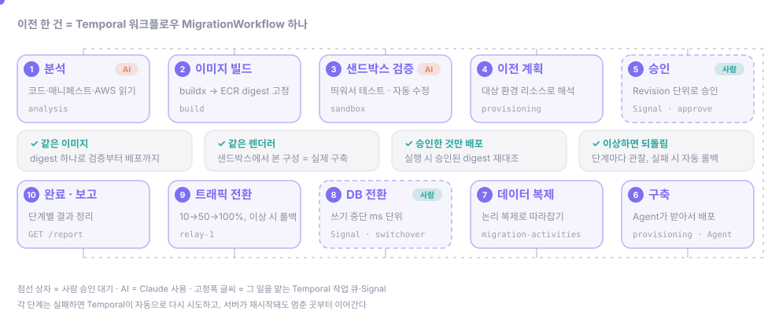
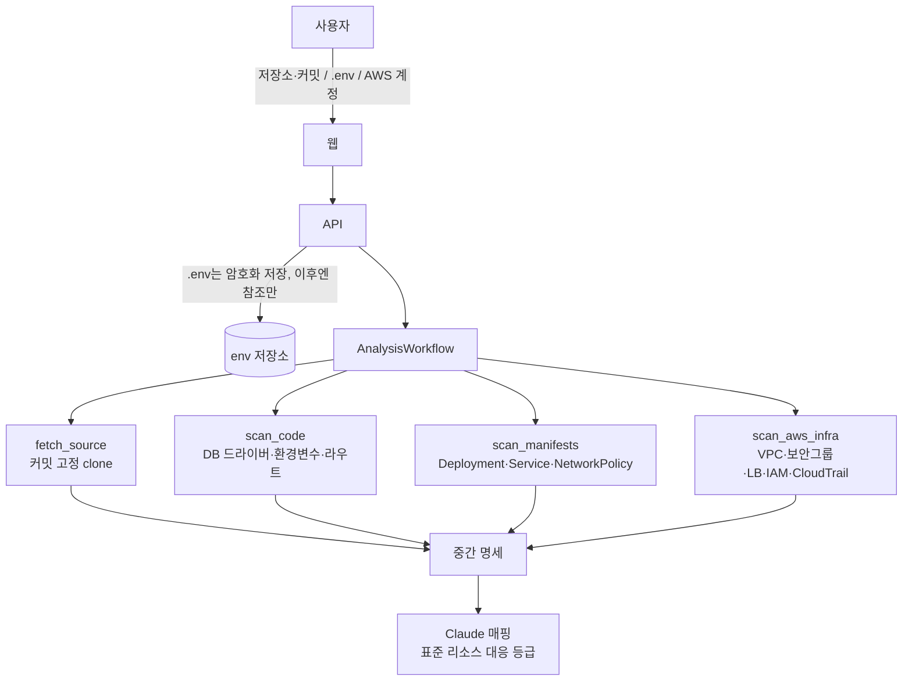
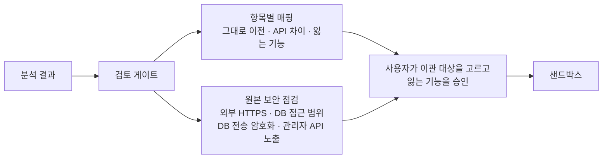
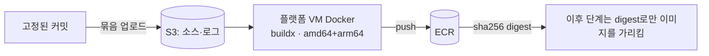
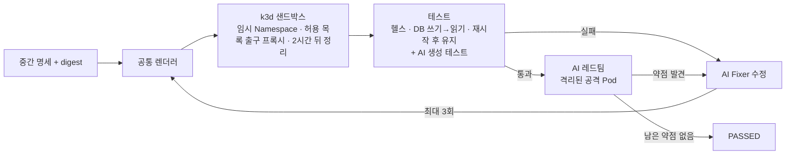
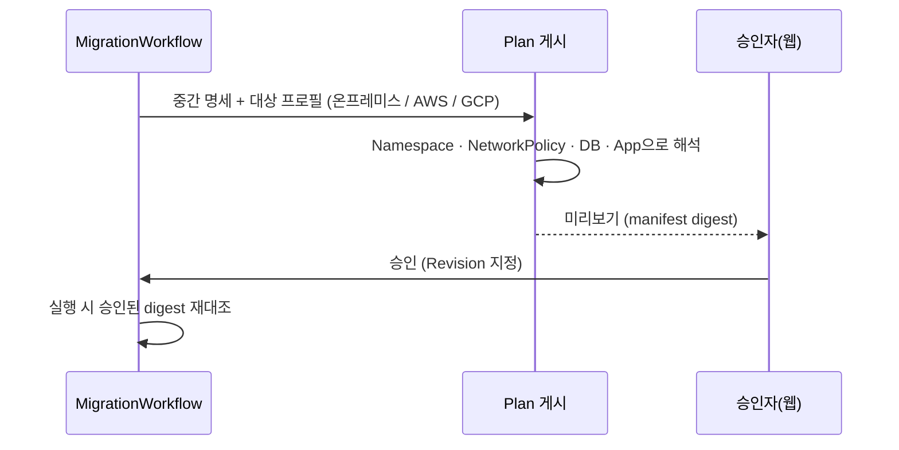
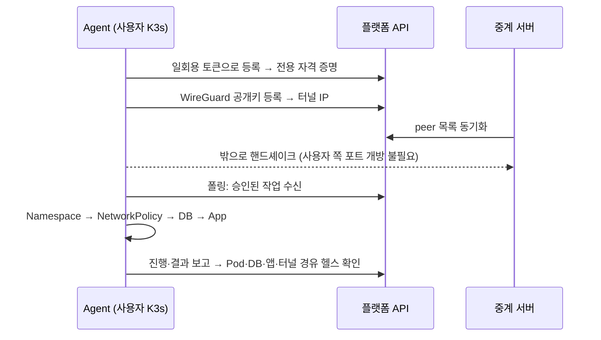
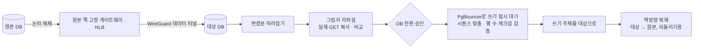
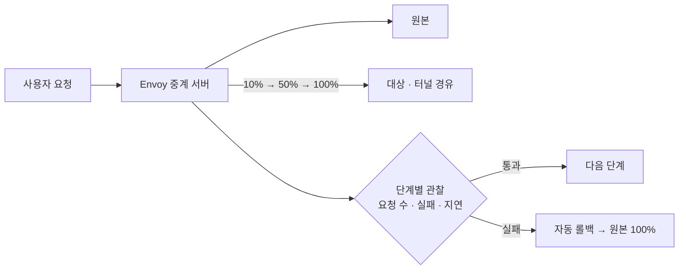
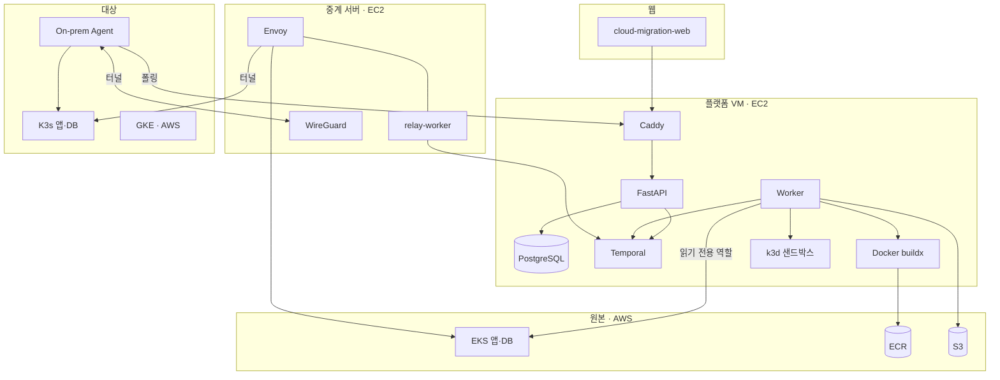

<p align="center"><a href="README.md">English</a> · <a href="README.ja.md">日本語</a> · <b>한국어</b></p>

<div align="center">

# Cloud Migration Platform

AWS EKS에서 돌고 있는 앱과 PostgreSQL을 온프레미스 K3s나 다른 클라우드로 옮기는 플랫폼입니다.


</div>

## 저장소 목록

이 README는 `cloud-migration-platform`을 설명합니다. 팀의 저장소는 다음과 같습니다.

| 저장소 | 역할 |
| --- | --- |
| [cloud-migration-platform](https://github.com/SoftBank-Hackathon-2026-Team-Jackal/cloud-migration-platform) | 백엔드: FastAPI API, Temporal Worker, 이전 로직(이 저장소) |
| [cloud-migration-web](https://github.com/SoftBank-Hackathon-2026-Team-Jackal/cloud-migration-web) | 웹 화면(TypeScript). 단계마다 음성으로 안내하는 자칼(Jackal)이 있습니다. 기본은 목업 데이터로 움직이고, SSE 모드에서는 플랫폼 이벤트로 움직입니다 |
| [demo-app](https://github.com/SoftBank-Hackathon-2026-Team-Jackal/demo-app) | 시연에 쓰는 이전 대상 앱: 메시지마다 어느 환경과 DB가 처리했는지 남기는 Go 채팅 앱 |
| [demo-app-vuln](https://github.com/SoftBank-Hackathon-2026-Team-Jackal/demo-app-vuln) | `demo-app`에 SQL 인젝션 취약점 3개를 넣은 버전. Sandbox 레드팀 확인용 |
| [demo-application](https://github.com/SoftBank-Hackathon-2026-Team-Jackal/demo-application) | 이전에 쓰던 시연 대상 앱(Python). 지금은 `demo-app`으로 바뀌었습니다 |
| [Softbank-Hackathon-2026-Finals](https://github.com/SoftBank-Hackathon-2026-Team-Jackal/Softbank-Hackathon-2026-Finals) | 결선 기록, PoC, 클라우드 설정(Terraform) |
| [.github](https://github.com/SoftBank-Hackathon-2026-Team-Jackal/.github) | 조직 프로필 |

<!-- TODO: 웹 E2E 녹화 (GIF 또는 mp4) -->

## 소개

사용자는 웹에서 GitHub 저장소, `.env` 파일, AWS 계정을 연결하고 옮길 범위를 고릅니다. 그다음은 플랫폼이 진행합니다.

1. 원본 코드와 EKS 매니페스트, AWS 리소스를 읽어 앱이 무엇을 쓰는지 정리하고, 사람이 결과를 검토합니다.
2. 이미지를 빌드하고 격리된 샌드박스에 띄워 테스트합니다. 테스트가 실패하면 AI(Claude)가 원인을 고치고 다시 돌립니다. 이어서 AI 레드팀이 샌드박스 사본을 공격하고, 찾은 약점을 고친 뒤 다시 확인합니다.
3. 대상 환경에 맞는 배포 계획을 만들고, 사람이 승인하면 배포합니다. 온프레미스는 사용자 클러스터에 설치한 Agent가 배포합니다.
4. DB를 논리 복제로 옮기고, 그림자 리허설로 실제 요청을 대상에도 보내 비교한 뒤, 짧게 쓰기를 멈추고 전환합니다. 트래픽은 단계적으로 넘깁니다.

옮기는 과정에서 원본의 보안 설정이 빠지지 않게 하는 데 신경을 썼습니다. 원본 보안그룹과 매니페스트에서 앱 사이 접속 관계를 뽑아, 대상 환경에서는 기본 차단 후 필요한 경로만 여는 NetworkPolicy로 다시 만듭니다.

## 동작 흐름

<p align="center">
  
</p>

이전 한 건은 [Temporal](https://temporal.io) 워크플로우 `MigrationWorkflow` 하나로 실행됩니다. 승인 대기처럼 오래 걸리는 단계가 있고, 그사이 서버가 재시작될 수도 있어서 Temporal을 골랐습니다. 워크플로우는 이력을 기준으로 멈춘 지점부터 다시 진행합니다.

| 구성 요소 | 이 저장소에서 |
| --- | --- |
| Workflow | `MigrationWorkflow`가 분석, 샌드박스, 승인, 데이터, 트래픽 단계를 자식 워크플로우로 차례로 실행 |
| Activity | git clone, AWS 조회, buildx, kubectl·Helm, DB 작업처럼 외부와 통신하는 일. 실패하면 자동 재시도 |
| Worker | 플랫폼 VM의 `worker` 컨테이너가 작업 큐 6개, 중계 서버의 `relay-worker`가 `relay-1` 큐를 처리 |
| Signal · Query | 승인(`approve`), DB 전환(`switchover`), 트래픽 롤백·재시도 / 상태 조회(`status`) |

단계마다 진행 이벤트(`analysis.*`, `sandbox.*`, `plan.*`, `provision.*`, `data.*`, `traffic.*`, `cutover.*`)가 저장되고, 웹은 `GET /migrations/{id}/events`(SSE)로 받아 화면에 보여 줍니다.

## 단계별 설명

<details open>
<summary><b>1. 연결과 분석</b></summary>



- AWS 계정은 CloudFormation으로 만든 읽기 전용 역할로 연결합니다. 옮길 범위는 EKS Namespace와 워크로드 단위로 고릅니다.
- `.env`는 암호화해서 저장하고, 분석 단계에서는 키 이름만 봅니다.
- 분석 결과(중간 명세)에는 앱이 쓰는 DB, 설정, 외부 노출, 접속 관계와 각각을 플랫폼 표준 리소스로 어떻게 바꿀지가 들어갑니다.

</details>

<details>
<summary><b>2. 샌드박스 전 검토</b></summary>



- 빌드하기 전에 사람이 분석 결과를 검토합니다. 항목마다 그대로 옮겨지는지, 대상에서 API가 달라지는지, 잃는 기능(예: WAF 연동 같은 ALB 전용 기능)이 무엇인지 보여 줍니다.
- 원본 인프라의 외부 HTTPS, DB 접근 범위, DB 전송 암호화, 관리자 API 노출을 점검하고, 이전 뒤에 보안 수준이 원본과 같은지 높아지는지를 항목별로 보여 줍니다.
- 사용자는 이관 대상별 이관 여부를 고르고, 잃는 기능을 확인해 승인합니다. 검토를 거친 매핑만 샌드박스로 넘어갑니다.

</details>

<details>
<summary><b>3. 이미지 빌드</b></summary>



- 플랫폼 VM의 Docker에서 buildx로 amd64·arm64 이미지를 빌드해 ECR에 올립니다. 빌드 중에는 인스턴스 메타데이터 접근을 막아 사용자 코드가 플랫폼 자격 증명을 읽지 못하게 했습니다.
- 이후 단계는 태그 대신 이미지 digest를 씁니다. 샌드박스에서 테스트한 이미지가 그대로 배포됩니다.

</details>

<details>
<summary><b>4. 샌드박스 검증과 레드팀</b></summary>



- 플랫폼 VM의 k3d 클러스터에 실행마다 임시 Namespace를 만듭니다. 2시간이 지나면 정리합니다.
- 밖으로 나가는 통신은 허용 목록 방식의 출구 프록시로만 나갑니다. 분석이 찾은 외부 호출과 원본에 남겨 두는 서비스(예: S3)만 열고, 나머지는 막고 기록합니다.
- 기본 테스트는 헬스 체크, DB 쓰기 후 읽기, 재시작 후 데이터 유지입니다. 여기에 AI가 만든 테스트가 더해집니다.
- 실패하면 원인을 분류(명세, 코드, 빌드, 렌더러, 환경)하고, Fixer가 설정이나 코드를 고친 뒤 다시 렌더링하고 테스트합니다. 최대 3번까지 시도합니다.
- 샌드박스와 실제 배포는 같은 렌더러(`shared_deployment_v2`)를 씁니다.

**AI 레드팀** ([ADR-008](docs/decisions/ADR-008.md))

- 테스트를 통과하면 AI 에이전트가 샌드박스 사본을 공격합니다. 공격 Pod는 앱 포트에만 접근할 수 있고, DNS, DB, 다른 Namespace, 인터넷, 클러스터 API에는 닿지 못합니다.
- 모델은 다음에 보낼 요청을 도구 이름과 경로로만 고릅니다. 출력에 호스트나 URL 필드가 없어서 다른 목적지를 고를 수 없습니다.
- 동의는 이전을 시작할 때 한 번 받습니다. 기본 강도는 관찰만(데이터를 바꾸지 않음)이고 시간 한도는 5분이며, 점검하는 동안 외부 호출을 끊습니다.
- 약점의 엔드포인트, 증거, 재현 방법은 실제로 보낸 요청과 실제 응답에서만 가져오고, 비밀값은 가립니다.
- 약점은 Fixer가 코드를 고치고, 다시 빌드한 이미지에 같은 요청을 보내 재검증합니다. 보안 수정은 최대 3회이고 이미지 digest 기준으로 추적합니다. 남은 약점은 표시하고 기록하며, 이전을 막지 않습니다.
- 결과는 소스 해시 기준으로 S3에 캐시해서, 같은 소스를 다시 이전할 때 같은 공격을 다시 하지 않습니다.

</details>

<details>
<summary><b>5. 배포 계획과 승인</b></summary>



- 대상 프로필(온프레미스, AWS, GCP)에 맞춰 Namespace, NetworkPolicy, DB, 앱 구성을 만들고 Revision으로 저장합니다.
- 승인은 Revision 단위로 받습니다. 배포할 때 이미지 digest가 승인 당시와 다르면 `ARTIFACT_DIGEST_MISMATCH`로 중단합니다.

</details>

<details>
<summary><b>6. 온프레미스 배포</b></summary>



- 사용자는 Agent Helm 차트를 한 번 설치하면 됩니다. Agent는 일회용 토큰으로 등록하고, 플랫폼 쪽으로만 접속합니다.
- WireGuard 터널도 Agent가 중계 서버로 먼저 연결하기 때문에 사용자 네트워크에서 포트를 열 필요가 없습니다.
- Agent는 승인된 작업을 폴링으로 받아 Namespace, NetworkPolicy, DB, 앱 순서로 배포하고 결과를 보고합니다. 실패하면 직전 Revision으로 되돌립니다.
- Agent는 GitHub Release와 OCI Helm 차트로 배포하고, 이미지는 digest로 고정합니다(현재 0.6.0).

</details>

<details>
<summary><b>7. 데이터 복제, 그림자 리허설, DB 전환</b></summary>



- 먼저 네트워크 사전 점검을 합니다. 데이터 터널은 원본 쪽 고정 게이트웨이와 NLB로 들어오고, 실행마다 자기 peer를 붙입니다([ADR-007](docs/decisions/ADR-007.md)). 다른 실행이 게이트웨이를 쓰고 있으면 가로채지 않고 `TUNNEL_IN_USE`로 멈춥니다.
- 스키마와 초기 데이터를 복사한 뒤 논리 복제로 변경분을 따라잡습니다. 대상 앱이 이미 만든 테이블은 그대로 두고, 없는 테이블만 복원합니다.
- 그림자 리허설([ADR-013](docs/decisions/ADR-013.md)): 복제가 따라잡으면 Envoy가 허용한 경로의 실제 GET 요청을 대상에도 복사합니다. 원본 두 번과 대상 한 번의 응답을 비교해 잡음 필드를 걸러 냅니다. 결과는 참고용이라 전환을 막지 않고, 불일치는 AI가 설명합니다.
- DB 전환은 두 번째 승인을 받은 뒤 진행합니다. PgBouncer에서 쓰기를 잠시 멈추고 시퀀스를 맞춘 뒤, 행 수와 체크섬을 비교하고 대상 DB로 넘깁니다.
- 전환 뒤에는 대상에서 원본으로 역방향 복제를 유지해 되돌릴 수 있게 합니다.
- EKS에서 GKE로 옮기는 검증에서는 쓰기 중단이 83ms였고, 행 수와 체크섬이 일치했습니다.

</details>

<details>
<summary><b>8. 트래픽 전환</b></summary>



- 중계 서버의 Envoy 가중치를 10%, 50%, 100% 순서로 바꿉니다. 단계마다 요청 수, 실패, 지연을 보고 기준을 넘으면 원본으로 되돌립니다.
- 웹에서 롤백과 재시도를 직접 할 수도 있습니다.
- 수동 단계 모드에서는 단계마다 "다음 단계"를 누르거나 `POST /migrations/{id}/traffic/advance`를 호출해야 넘어갑니다.
- 시연과 점검을 위해 대상으로 가는 길에 장애(차단, 거절, 패킷 손실)를 넣어 자동 롤백을 보여 줄 수 있습니다.

</details>

## 앱 관측

- 이전한 앱은 원본과 대상 클러스터 양쪽에서 OpenTelemetry(OTLP/HTTP)를 플랫폼으로 보냅니다.
- Caddy는 수집 토큰이 있는 POST만 받습니다. 메트릭은 Prometheus로, 트레이스는 Jaeger로 보냅니다.
- 웹의 트래픽 전환·DB 전환 화면에 패널로 보여 줘서, 환경별로 앱 자체의 지연과 오류를 비교할 수 있습니다.

## 아키텍처



## 사용한 클라우드 서비스

| 클라우드 | 서비스 | 용도 |
| --- | --- | --- |
| AWS | EC2, SSM, CloudFormation | 플랫폼·중계 서버 운영, 배포, 연결 역할 템플릿 |
| AWS | EKS, IAM(역할·Access Entry), CloudTrail, VPC | 원본 분석(읽기 전용), 데이터 이전용 별도 역할 |
| AWS | ECR, S3 | 빌드 이미지, 소스·빌드 로그 |
| Google Cloud | GKE, Terraform | 클라우드 대상 배포, 데이터 이전 검증 |
| 온프레미스 | K3s, Helm, WireGuard | Agent 배포, 터널 |

## AI 사용 범위

AI는 Claude를 씁니다. 사용하는 곳은 세 군데입니다.

- 분석: 원본 구성을 플랫폼 표준 리소스에 대응시킵니다. 판단마다 근거(파일과 줄 번호)를 남기고, 사람이 계획 미리보기에서 확인합니다.
- 샌드박스: 테스트를 만들고, 실패한 테스트의 원인을 고치고, 샌드박스 사본을 레드팀으로 공격하고, 그림자 리허설의 불일치를 설명합니다. 테스트, 수정, 공격은 외부 통신이 허용 목록으로 제한된 샌드박스 안에서만 동작합니다.
- 비용과 데이터: 이전 1건 $5, 하루 $20, 한 달 $100 상한을 코드로 적용합니다. 모델에는 마스킹한 근거 일부만 보내고 `.env` 값과 전체 코드는 보내지 않습니다. 자세한 내용은 [ADR-004](docs/decisions/ADR-004.md)에 있습니다.

## 구현 현황

데모 서버에서 실제로 실행되는 범위입니다.

| 단계 | 상태 |
| --- | --- |
| 연결·범위 선택, 분석, 검토, 이미지 빌드, 샌드박스 검증 | 동작 |
| 샌드박스 레드팀(공격, 수정, 재검증) | 동작 |
| 배포 계획·승인, 온프레미스 배포(Agent·터널) | 동작 |
| 데이터 복제, 그림자 리허설, DB 전환 | EKS→온프레미스 K3s, EKS→GKE 모두 동작 |
| 트래픽 전환 | 동작. 온프레미스 K3s로 끝까지 진행한 실제 실행에서 확인 |

## 주요 설계 결정

- Temporal을 쓴 이유와 실행 중인 워크플로우를 유지하면서 코드를 바꾸는 방법: [ADR-001](docs/decisions/ADR-001.md)
- 첫 Provisioning 작업 범위와 병렬 작업을 나눈 기준: [ADR-002](docs/decisions/ADR-002.md)
- 샌드박스에서 검증한 이미지 digest를 운영 배포에 그대로 쓰는 방식: [ADR-003](docs/decisions/ADR-003.md)
- AI 비용 상한과 모델에 보내도 되는 데이터: [ADR-004](docs/decisions/ADR-004.md)
- 원본·대상 환경 연결 방식(AWS 역할 위임, GCP 고정 프로젝트): [ADR-005](docs/decisions/ADR-005.md)
- 트래픽 전환을 Envoy 중계로 하는 이유: [ADR-006](docs/decisions/ADR-006.md)
- 온프레미스 데이터 이전 경로를 원본 쪽 게이트웨이로 정한 이유: [ADR-007](docs/decisions/ADR-007.md)
- 샌드박스 레드팀을 안전하게 돌리는 방식(격리, 동의, 수정 후 재검증): [ADR-008](docs/decisions/ADR-008.md)
- 플랫폼을 FastAPI API와 Temporal Worker로 구성한 이유: [ADR-009](docs/decisions/ADR-009.md)
- 데이터를 PostgreSQL 논리 복제로 옮기고 원본 쪽 PgBouncer로 전환하는 이유: [ADR-010](docs/decisions/ADR-010.md)
- Worker가 `kubectl exec`로 SQL을 실행하고 EKS 토큰을 Activity 사이에서 재사용하는 이유: [ADR-011](docs/decisions/ADR-011.md)
- 전환할 때 원본 앱의 NetworkPolicy에 허용 규칙만 더하는 이유: [ADR-012](docs/decisions/ADR-012.md)
- DB 전환 승인 전에 그림자 리허설로 대상 응답을 관찰하는 이유: [ADR-013](docs/decisions/ADR-013.md)
- 시연 플랫폼을 단일 EC2에서 운영하고 main 커밋만 배포하는 방식: [ADR-014](docs/decisions/ADR-014.md)

비밀값은 저장소와 이벤트, 로그에 남기지 않습니다. `.env`는 암호화해서 저장하고 이후에는 참조만 넘기며, Agent와 승인자 토큰은 DB에 해시만 저장합니다.

## 개발 방식

- 결정은 `docs/decisions/`의 ADR 14건과 영역별 명세(`specs/`)로 남겼습니다. 작업은 `tickets/`에 티켓 154건으로 나눠, 검토한 대안과 선택 이유, 확인 결과를 같이 적었습니다.
- 변경은 모두 PR로 올렸고, CI(ruff, pytest 약 3,900개)를 통과한 뒤 squash 병합했습니다. 지금까지 병합한 PR은 약 225건입니다.
- 분석·검증, Provisioning, 데이터 이전, 트래픽, 웹으로 담당을 나누고, 영역 사이 인터페이스는 `packages/contracts`와 이벤트 스키마로 맞췄습니다.

## 저장소 구조

| 경로 | 역할 |
| --- | --- |
| `apps/api` | FastAPI. 이전 시작·조회·승인, 연결, Agent·터널, 이벤트(SSE), 보고 |
| `apps/worker` | Temporal Workflow, Activity, Worker |
| `packages/contracts` | 이벤트, 작업 큐, 입력 모델 정의 |
| `packages/scanners` | 코드, 매니페스트, AWS 분석 |
| `packages/agents` | AI 매핑, 테스트 생성, Fixer |
| `packages/testsuite` | 샌드박스 테스트 실행 |
| `packages/providers` | 렌더러, NetworkPolicy, 대상별 배포, 온프레미스 Agent·터널 |
| `packages/data` | 데이터 복제, DB 전환 |
| `packages/traffic` | Envoy 설정, 트래픽 전환 |
| `infra/` | 데모 서버, Agent Helm 차트, 중계 서버, 연결 템플릿, Terraform |
| `docs/`, `specs/`, `tickets/` | 설계 결정, 명세, 작업 기록 |

## 로컬 실행

Python 3.11, [uv](https://docs.astral.sh/uv/), Docker Compose가 필요합니다. 자세한 실행 방법과 Agent 등록, 파일별 역할은 [개발 가이드](docs/development.md)를 참고하세요.

```bash
cp .env.example .env
make setup
make infra-up    # PostgreSQL, Temporal
make workers     # 다른 터미널에서
make api         # 다른 터미널에서, http://localhost:8000/docs
```

## 문서

- [개발 가이드](docs/development.md)
- [설계 결정(ADR)](docs/decisions/)
- [Temporal 사용 가이드](docs/architecture/temporal-flow.md)
- [이벤트 가이드](docs/engineering/events-guide.md)
- [`.env` 참조 가이드](docs/engineering/env-file-guide.md)
- [온프레미스 Agent 설치·운영](specs/provisioning/onprem-agent-install.md)
- [데모 서버 운영](infra/demo/README.md)

<!-- TODO: 팀 소개 -->
