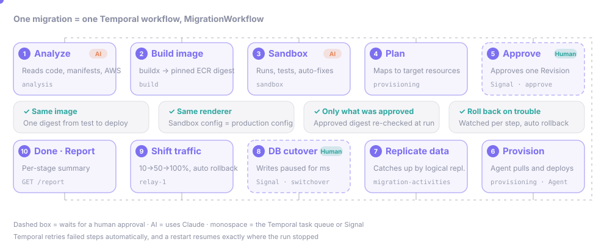
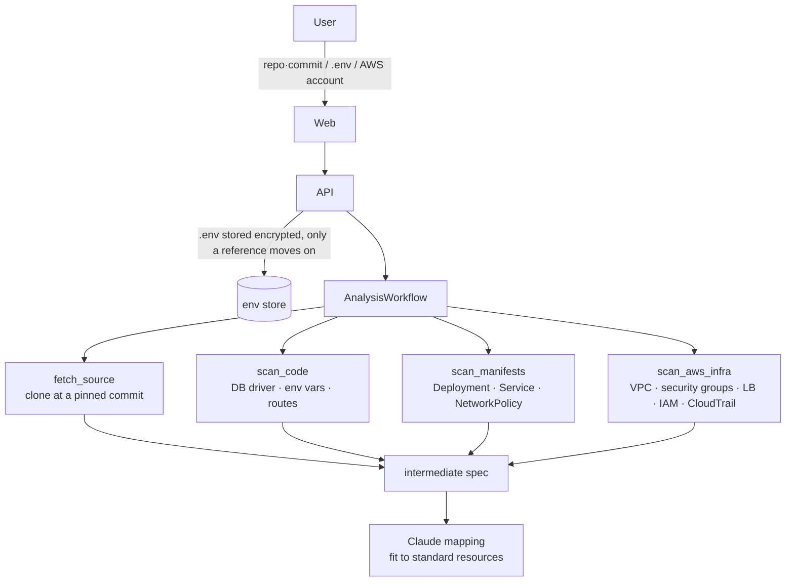
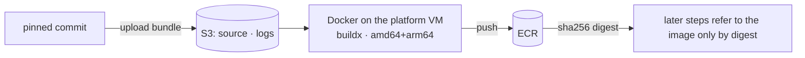
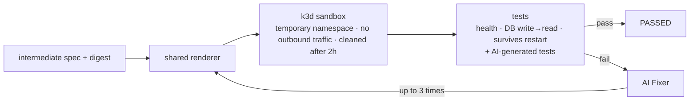
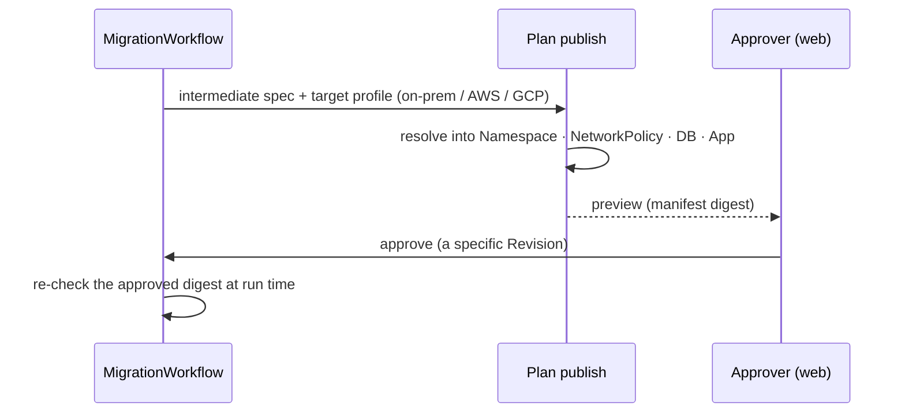
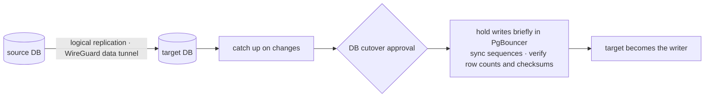
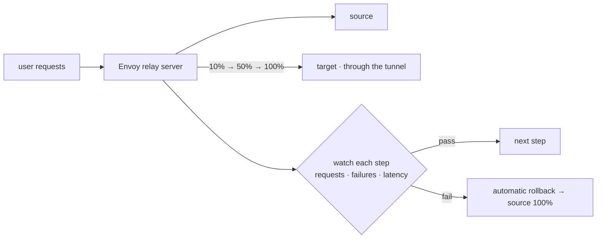
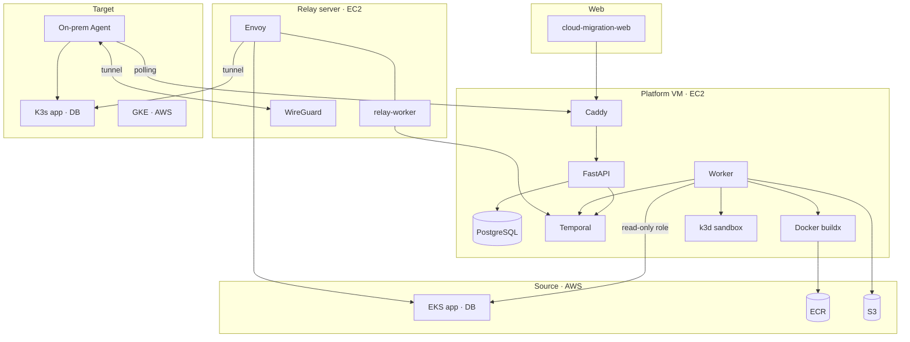

<p align="center"><b>English</b> · <a href="README.ja.md">日本語</a> · <a href="README.ko.md">한국어</a></p>

<div align="center">

# Cloud Migration Platform

A platform for moving an app and its PostgreSQL database running on AWS EKS to on-premises K3s or another cloud.


</div>

## Repositories

This README covers `cloud-migration-platform`. All repositories of the team:

| Repository | Role |
| --- | --- |
| [cloud-migration-platform](https://github.com/SoftBank-Hackathon-2026-Team-Jackal/cloud-migration-platform) | Backend: FastAPI API, Temporal workers, migration logic (this repository) |
| [cloud-migration-web](https://github.com/SoftBank-Hackathon-2026-Team-Jackal/cloud-migration-web) | Web UI (TypeScript). Runs on mock data by default, or on platform events over SSE |
| [demo-app](https://github.com/SoftBank-Hackathon-2026-Team-Jackal/demo-app) | Migration target used in the demo: a Go chat app whose messages record which environment and DB served them |
| [demo-app-vuln](https://github.com/SoftBank-Hackathon-2026-Team-Jackal/demo-app-vuln) | Variant of `demo-app` with three SQL injection flaws, used to check the sandbox red team |
| [demo-application](https://github.com/SoftBank-Hackathon-2026-Team-Jackal/demo-application) | Earlier demo target (Python), replaced by `demo-app` |
| [Softbank-Hackathon-2026-Finals](https://github.com/SoftBank-Hackathon-2026-Team-Jackal/Softbank-Hackathon-2026-Finals) | Finals notes, PoCs and cloud setup (Terraform) |
| [.github](https://github.com/SoftBank-Hackathon-2026-Team-Jackal/.github) | Organization profile |

<!-- TODO: web E2E recording (GIF or mp4) -->

## Overview

In the web UI, the user connects a GitHub repository, a `.env` file, and an AWS account, and picks what to migrate. The platform does the rest:

1. It reads the source code, the EKS manifests, and the AWS resources to work out what the app depends on.
2. It builds an image and runs it in an isolated sandbox. If a test fails, AI (Claude) fixes the cause and runs the tests again.
3. It creates a deployment plan for the target environment and deploys it once a person approves it. For on-premises targets, an Agent installed in the user's cluster does the deployment.
4. It copies the database with logical replication, then pauses writes briefly to switch over. Traffic is moved in steps.

We paid particular attention to keeping the source's security settings during the move. The platform extracts which components talk to each other from the source security groups and manifests, and recreates that in the target as NetworkPolicy that denies by default and opens only the needed paths.

## How it runs

<p align="center">
  
</p>

Each migration runs as a single [Temporal](https://temporal.io) workflow, `MigrationWorkflow`. Some steps take a long time (waiting for approval, for example) and the server may restart in the meantime, which is why we chose Temporal: the workflow resumes from where it stopped, based on its history.

| Component | In this repository |
| --- | --- |
| Workflow | `MigrationWorkflow` runs analysis, sandbox, approval, data, and traffic as child workflows, in order |
| Activity | Anything that talks to the outside world: git clone, AWS calls, buildx, kubectl and Helm, database work. Retried automatically on failure |
| Worker | The `worker` container on the platform VM handles six task queues; `relay-worker` on the relay server handles `relay-1` |
| Signal · Query | Approval (`approve`), DB cutover (`switchover`), traffic rollback and retry / status (`status`) |

Each step stores progress events (`analysis.*`, `sandbox.*`, `plan.*`, `provision.*`, `data.*`, `traffic.*`, `cutover.*`), and the web UI reads them from `GET /migrations/{id}/events` (SSE).

## Steps

<details open>
<summary><b>1. Connect and analyze</b></summary>



- The AWS account is connected through a read-only role created with CloudFormation. The scope is chosen per EKS namespace and workload.
- `.env` is stored encrypted; analysis only looks at the key names.
- The analysis result (the intermediate spec) lists the database, configuration, exposure, and connections the app uses, and how each maps to the platform's standard resources.

</details>

<details>
<summary><b>2. Build the image</b></summary>



- Images are built for amd64 and arm64 with buildx on the platform VM's Docker and pushed to ECR. Access to instance metadata is blocked during the build so user code cannot read the platform's credentials.
- Later steps refer to the image by digest rather than by tag, so the image tested in the sandbox is the one that gets deployed.

</details>

<details>
<summary><b>3. Sandbox verification</b></summary>



- Each run gets a temporary namespace in a k3d cluster on the platform VM, with outbound traffic blocked. It is cleaned up after two hours.
- The standard tests are a health check, a database write then read, and data surviving a restart. AI-generated tests are added on top.
- On failure, the Fixer changes the setup, then it is rendered and tested again, up to three attempts.
- The sandbox and the real deployment use the same renderer (`shared_deployment_v2`).

</details>

<details>
<summary><b>4. Deployment plan and approval</b></summary>



- Based on the target profile (on-premises, AWS, or GCP), the platform builds the namespace, NetworkPolicy, database, and app configuration and stores it as a Revision.
- Approval is given per Revision. If the image digest at deploy time differs from the approved one, deployment stops with `ARTIFACT_DIGEST_MISMATCH`.

</details>

<details>
<summary><b>5. On-premises deployment</b></summary>


- The user installs the Agent Helm chart once. The Agent enrolls with a one-time token and only makes outbound connections to the platform.
- The Agent also opens the WireGuard tunnel to the relay server, so no port has to be opened on the user's network.
- The Agent polls for approved jobs, deploys the namespace, NetworkPolicy, database, and app in that order, and reports back. On failure it rolls back to the previous Revision.

</details>

<details>
<summary><b>6. Data replication and DB cutover</b></summary>



- The schema and initial data are copied first, then logical replication catches up on changes.
- Cutover happens after a second approval. Writes are paused in PgBouncer, sequences are synced, row counts and checksums are compared, and the target becomes the writer.
- In our EKS to GKE test, writes were paused for 83 ms and row counts and checksums matched.

</details>

<details>
<summary><b>7. Traffic shift</b></summary>



- The Envoy weights on the relay server move to 10%, 50%, then 100%. At each step the platform checks request count, failures, and latency, and rolls back to the source if a threshold is crossed.
- Rollback and retry can also be triggered from the web UI.

</details>

## Architecture



## Cloud services

| Cloud | Services | Used for |
| --- | --- | --- |
| AWS | EC2, SSM, CloudFormation | Running the platform and relay server, deployment, connection role templates |
| AWS | EKS, IAM (roles, access entries), CloudTrail, VPC | Read-only source analysis, a separate role for data migration |
| AWS | ECR, S3 | Built images, source bundles and build logs |
| Google Cloud | GKE, Terraform | Cloud targets, data migration testing |
| On-premises | K3s, Helm, WireGuard | Agent deployment, tunnel |

## Use of AI

We use Claude in three places:

- Analysis: mapping the source setup to the platform's standard resources. Each decision keeps its evidence (file and line), and a person reviews it in the plan preview.
- Sandbox: writing tests and fixing failed ones. This only runs inside the sandbox, where outbound traffic is blocked.
- Cost and data: spending caps of $3 per migration, $20 per day, and $100 per month are enforced in code. The model only receives masked snippets of evidence, never `.env` values or the full codebase. See [ADR-004](docs/decisions/ADR-004.md).

## Current status

What runs on the demo server today:

| Step | Status |
| --- | --- |
| Connection and scope selection, analysis, image build, sandbox verification | Working |
| Deployment plan and approval, on-premises deployment (Agent and tunnel) | Working. Confirmed up to deploying the app and database to the user's K3s |
| Traffic shift | Being verified. Confirmed in a real run up to the start of the stepped shift |
| Data replication and DB cutover | Verified for EKS to GKE. The on-premises path is in progress ([ADR-007](docs/decisions/ADR-007.md)) |

## Design decisions

- Why Temporal, and how we change code while workflows are running: [ADR-001](docs/decisions/ADR-001.md)
- Reusing the sandbox-verified image digest for the production deployment: [ADR-003](docs/decisions/ADR-003.md)
- How source and target environments are connected (AWS role delegation, a fixed GCP project): [ADR-005](docs/decisions/ADR-005.md)
- Why traffic is shifted through an Envoy relay: [ADR-006](docs/decisions/ADR-006.md)
- Why the on-premises data path enters through a gateway on the source side: [ADR-007](docs/decisions/ADR-007.md)
- Why the platform is a FastAPI API plus Temporal workers: [ADR-009](docs/decisions/ADR-009.md)
- Why data moves by PostgreSQL logical replication and switches over through PgBouncer on the source side: [ADR-010](docs/decisions/ADR-010.md)
- Why the worker runs SQL through `kubectl exec` and reuses the EKS token between Activities: [ADR-011](docs/decisions/ADR-011.md)
- Why switchover only adds NetworkPolicy allow rules to the source app: [ADR-012](docs/decisions/ADR-012.md)
- Why a shadow rehearsal observes the target before the DB switchover is approved: [ADR-013](docs/decisions/ADR-013.md)
- How the demo platform runs on one EC2 host and deploys only main commits: [ADR-014](docs/decisions/ADR-014.md)

Secrets are kept out of the repository, events, and logs. `.env` is stored encrypted and only referenced afterwards, and Agent and approver tokens are stored as hashes.

## How we worked

- Decisions are recorded in 7 ADRs under `docs/decisions/` and in per-area specs (`specs/`). Work was split into 136 tickets under `tickets/`, each noting the alternatives considered, the reason for the choice, and how it was checked.
- Every change went through a PR and was squash-merged after CI (ruff and about 3,000 pytest tests). About 160 PRs have been merged so far.
- Ownership was split into analysis and verification, provisioning, data migration, traffic, and web. Interfaces between areas are defined in `packages/contracts` and the event schema.

## Repository layout

| Path | Contents |
| --- | --- |
| `apps/api` | FastAPI: start, read, and approve migrations; connections; Agent and tunnel; events (SSE); report |
| `apps/worker` | Temporal workflows, activities, and workers |
| `packages/contracts` | Event, task queue, and input model definitions |
| `packages/scanners` | Code, manifest, and AWS analysis |
| `packages/agents` | AI mapping, test generation, Fixer |
| `packages/testsuite` | Sandbox test runner |
| `packages/providers` | Renderer, NetworkPolicy, per-target deployment, on-premises Agent and tunnel |
| `packages/data` | Data replication and DB cutover |
| `packages/traffic` | Envoy configuration and traffic shift |
| `infra/` | Demo server, Agent Helm chart, relay server, connection templates, Terraform |
| `docs/`, `specs/`, `tickets/` | Design decisions, specs, work records |

## Running locally

You need Python 3.11, [uv](https://docs.astral.sh/uv/), and Docker Compose. Full instructions, Agent enrollment, and a file-by-file guide are in the [development guide](docs/development.md) (in Korean).

```bash
cp .env.example .env
make setup
make infra-up    # PostgreSQL, Temporal
make workers     # in another terminal
make api         # in another terminal, then open http://localhost:8000/docs
```

## Documentation

Most design documents are written in Korean.

- [Development guide](docs/development.md)
- [Design decisions (ADR)](docs/decisions/)
- [Temporal guide](docs/architecture/temporal-flow.md)
- [Events guide](docs/engineering/events-guide.md)
- [`.env` reference guide](docs/engineering/env-file-guide.md)
- [On-premises Agent installation and operation](specs/provisioning/onprem-agent-install.md)
- [Connecting a Mac as the on-prem target (demo runbook)](specs/provisioning/onprem-agent-local-mac.md)
- [Demo server operation](infra/demo/README.md)

<!-- TODO: team -->
