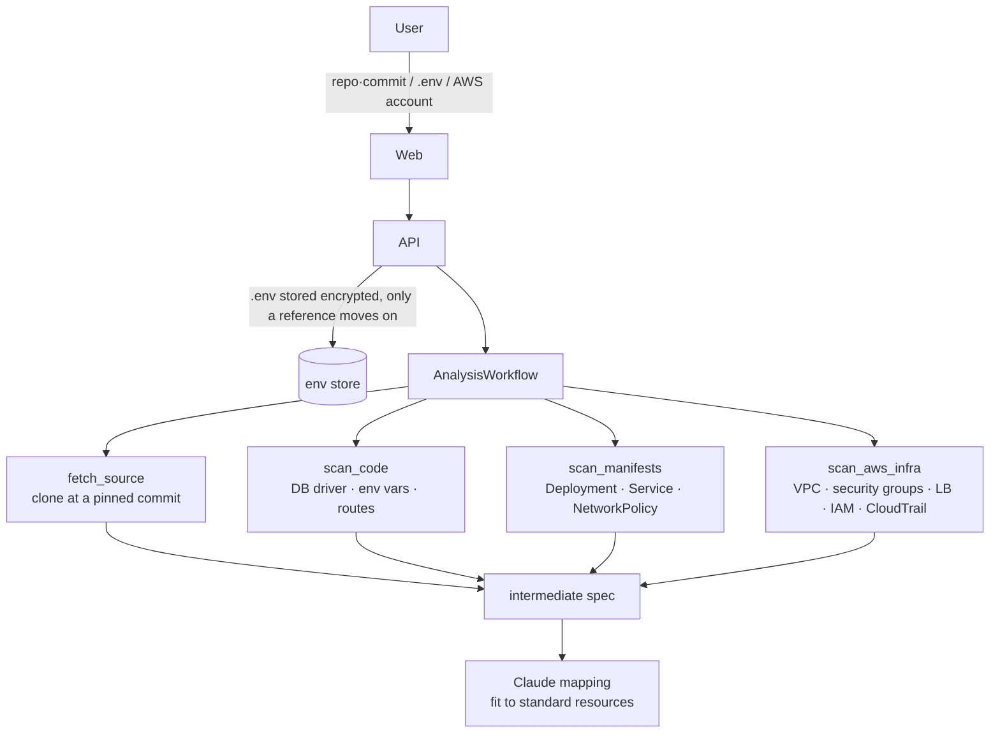
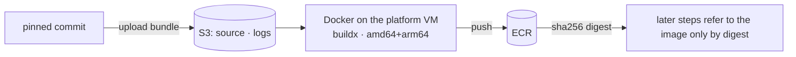
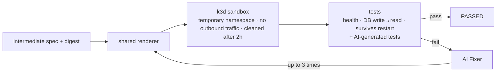
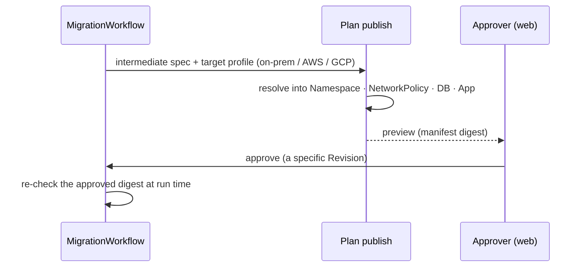
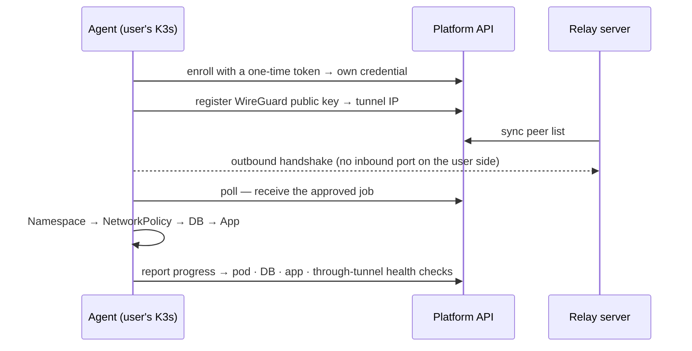
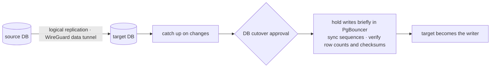
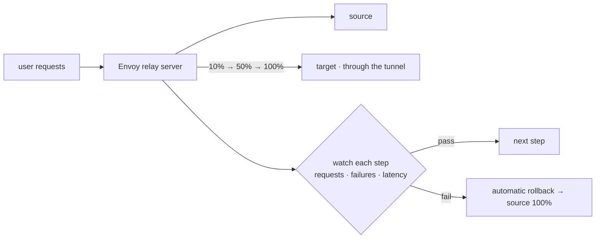
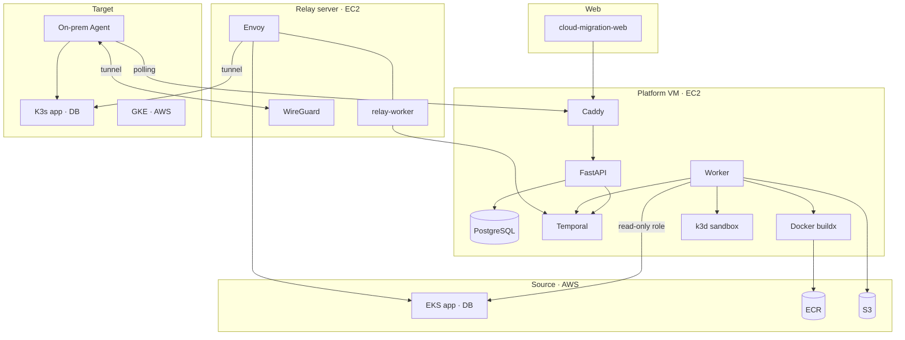

<div align="center">

<p align="center"><b>English</b> · <a href="README.ja.md">日本語</a> · <a href="README.ko.md">한국어</a></p>

# Cloud Migration Platform

### Move a running EKS app and its database — without stopping it, at the same security level

To on-premises (K3s) or another cloud — AI analyzes it and tries it in a sandbox first, and only a human-approved configuration is deployed.


</div>

<!-- TODO: web E2E recording (GIF, or an mp4 dropped into the GitHub editor) -->
<p align="center"><i>Demo recording goes here — one migration in the web UI, from analysis to traffic shift</i></p>

---

## At a glance

| The challenge's question | Our answer |
| --- | --- |
| Can a running app move to another environment **without stopping**? | The database catches up through logical replication, then writes pause only for milliseconds at cutover. Traffic moves in steps (10→50→100%) and rolls back automatically on trouble |
| Can security and governance stay **at the same level everywhere**? | We extract "who connects to whom" from the source security groups and manifests, and rebuild it in the target as NetworkPolicy: deny by default, open only the paths the app used |
| On-premises, how do you reproduce **what the cloud gave you for free**? | An Agent in the user's cluster deploys while only connecting outward (polling + WireGuard), so no inbound port is opened. Load balancers and managed DBs become standard building blocks |
| How far can **AI be trusted** to inspect and fix? | AI tests and fixes only inside a sandbox with outbound traffic blocked. Production gets only the Revision a human approved, and the approved image and config digests are re-checked at run time |

## Why we built it

An app that ran well in the cloud **quietly gets weaker** the moment it moves. Security groups disappear, managed databases and load balancers are gone, and nobody remembers which ports had to be open. So migrations are usually matched by hand, piece by piece, and the service is often stopped while it moves.

We turned this into one flow: **analyze → verify → approve → execute**. People only make decisions; everything that can be checked, the platform checks.

---

## How it flows

<p align="center">
  
</p>

One migration is one [Temporal](https://temporal.io) workflow, `MigrationWorkflow`. Whether it takes days, the server restarts, or it waits for a human approval, it never loses its state and continues from where it stopped.

| Building block | In this platform |
| --- | --- |
| **Workflow** — order and waiting | `MigrationWorkflow` calls child workflows in turn (analysis · sandbox · approval · data · traffic). After a restart it replays its history and continues |
| **Activity** — the real outside work | clone, AWS reads, buildx, kubectl·Helm, DB writes. Failures are retried automatically, so each one is safe to run twice |
| **Worker** — polls a queue and runs code | `worker` on the platform VM serves six queues; `relay-worker` on the relay server serves `relay-1` |
| **Signal · Query** — the human link | approval `approve`, DB cutover `switchover`, rollback·retry / state `status` |

Every step emits progress events (`analysis.*` `sandbox.*` `plan.*` `provision.*` `data.*` `traffic.*` `cutover.*`), and the web UI receives them live from `GET /migrations/{id}/events` (SSE).

---

## Feature flows

<details open>
<summary><b>① Connect and analyze</b> — find out what has to move</summary>



- The AWS account is connected through a **read-only role** created with CloudFormation; the scope is chosen per EKS namespace and workload.
- `.env` values are encrypted once; analysis reads **key names only**.
- The result is an **intermediate spec**: what the app uses (DB, config, exposure, connections) and how each maps to our standard resources (as-is / must change).

</details>

<details>
<summary><b>② Build the image</b> — pin the same source to the same image</summary>



- During the build, the instance metadata service (credentials) is blocked, so user code cannot steal platform permissions.
- Sandbox and production use the **same digest**, so the image that was tested is the image that ships.

</details>

<details>
<summary><b>③ Sandbox verification</b> — AI runs it first and fixes it</summary>



- Sandbox and production use the **same renderer** (`shared_deployment_v2`).
- AI changes things freely only in this isolated space, and every fix must pass the tests again before moving on.

</details>

<details>
<summary><b>④ Plan and approval</b> — a human approves a plan fitted to the target</summary>



- **NetworkPolicy** built from connection intent: deny everything by default, open only the paths the source used, such as app → DB.
- An approval is valid for one Revision only; if the digest differs at run time (`ARTIFACT_DIGEST_MISMATCH`), nothing is deployed.

</details>

<details>
<summary><b>⑤ On-premises provisioning</b> — deploy into the user's cluster without opening a port</summary>



- The user installs the Agent Helm chart **once**. On failure it restores the previous Revision.

</details>

<details>
<summary><b>⑥ Data replication and DB cutover</b> — writes barely stop</summary>



- Cross-cloud check (EKS→GKE): writes paused for **83 ms**, row counts and checksums matched, zero app write errors.

</details>

<details>
<summary><b>⑦ Traffic shift</b> — move in steps, roll back on trouble</summary>



</details>

---

## Architecture



## Cloud services we use

| Cloud | Services | Used for |
| --- | --- | --- |
| AWS | EC2 · SSM · CloudFormation | running the platform and relay, SSH-less deploys, connection-role templates |
| AWS | EKS · IAM roles and access entries · CloudTrail · VPC | read-only source analysis, a separate least-privilege role for data migration |
| AWS | ECR · S3 | digest-pinned images, source bundles and logs |
| Google Cloud | GKE · Terraform | cloud targets and cross-cloud data migration checks |
| On-premises | K3s · Helm · WireGuard | Agent deployment, outbound-only tunnel |

## Where AI is used, and its guardrails

| Where | What | Guardrail |
| --- | --- | --- |
| Analysis | Maps the source setup to standard resources | Every judgment keeps its evidence (file:line), and a human reviews it in the plan preview |
| Sandbox | Generates tests, fixes failures (Fixer) | Only in a temporary space with outbound traffic blocked; a fix must pass the tests again |
| Everywhere | Claude calls | Cost caps enforced in code ($3 per migration · $20 per day · $100 per month) and a usage ledger. The model receives only masked evidence snippets — never `.env` values or the whole codebase ([ADR-004](docs/decisions/ADR-004.md)) |

## What works today

> What the demo shows is not a mockup — it runs on the demo server. Parts still in progress are marked as such.

| Stage | Status |
| --- | --- |
| Connection · scope selection, analysis, image build, sandbox verification | ✅ Runs for real on the demo server |
| Plan · approval, on-premises provisioning (Agent · tunnel) | ✅ Runs for real — app and DB deployed to the user's K3s, all four checks passing |
| Traffic shift | 🟡 Being verified in real runs — entry into the stepped weight shift confirmed |
| Data replication · DB cutover | 🟡 Verified cross-cloud (EKS→GKE) · on-premises path in progress ([ADR-007](docs/decisions/ADR-007.md)) |

## Technical decisions we thought hard about

- **Never lose a long-running job** — Temporal survives hours-long approval waits and server restarts. When code changes while migrations are running, patch markers separate old runs from new ones ([ADR-001](docs/decisions/ADR-001.md)).
- **Deploy only what was verified** — sandbox and production share the image digest and the renderer, and the approved digest is re-checked at run time ([ADR-003](docs/decisions/ADR-003.md)).
- **Never punch holes on the user's side** — the on-prem Agent and its tunnel only connect outward. The data tunnel direction follows the same rule ([ADR-007](docs/decisions/ADR-007.md)).
- **Never leak secrets** — `.env` is stored encrypted and only referenced afterwards; Agent and approver tokens are stored as digests only.
- **Split permissions** — the source connection is a read-only role; data migration uses a separate role limited to two namespaces.

## How the team worked

- Decisions live in **7 ADRs** and per-area specs (`specs/`); work was split into **136 tickets** (`tickets/`) that record alternatives, the reason for each choice, and the checks done.
- Every change went through branch → PR → CI (ruff, about **3,000** pytest tests) → squash merge; about 160 PRs are merged.
- Each area (analysis·verification / provisioning / data migration / traffic / web) had an owner, and areas agreed through `packages/contracts` and the event schema.

---

## Repository layout

| Path | Role |
| --- | --- |
| `apps/api` | FastAPI — start·read·approve migrations, connections, Agent·tunnel, events (SSE), report |
| `apps/worker` | Temporal workflows · activities · workers |
| `packages/contracts` | Contracts — events, task queues, input models |
| `packages/scanners` | Code · manifest · AWS analysis |
| `packages/agents` | AI mapping · test generation · Fixer |
| `packages/testsuite` | Sandbox test runner |
| `packages/providers` | Renderer, NetworkPolicy, per-target provisioning, on-prem Agent·tunnel |
| `packages/data` | Data replication · DB cutover |
| `packages/traffic` | Envoy config · traffic shift |
| `infra/` | Demo server, Agent Helm chart, relay server, connection templates, Terraform |
| `docs/` · `specs/` · `tickets/` | Design decisions, specs, work records |

## Getting started

Requirements: Python 3.11, [uv](https://docs.astral.sh/uv/), Docker Compose. Full local setup, Agent enrollment, and a file-by-file guide are in the [development guide](docs/development.md) (Korean).

```bash
cp .env.example .env
make setup
make infra-up    # PostgreSQL, Temporal
make workers     # in another terminal
make api         # in another terminal → http://localhost:8000/docs
```

## Further reading

Most design documents are written in Korean.

[Development guide](docs/development.md) · [Design decisions (ADR)](docs/decisions/) · [Temporal guide](docs/architecture/temporal-flow.md) · [Events guide](docs/engineering/events-guide.md) · [`.env` reference guide](docs/engineering/env-file-guide.md) · [On-prem Agent install·operations](specs/provisioning/onprem-agent-install.md) · [Demo server operations](infra/demo/README.md)

<!-- TODO: team -->
