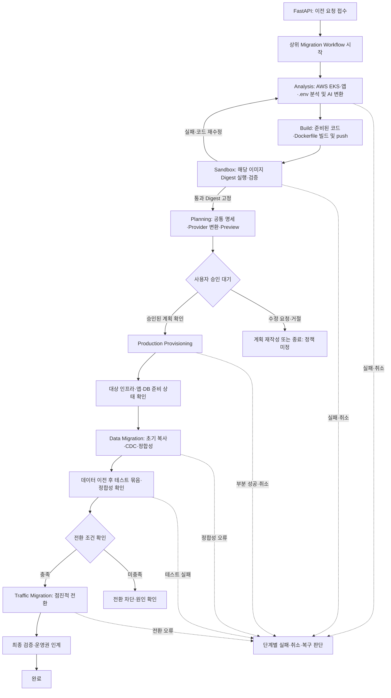

# Cloud Migration Platform — Temporal 실행 흐름 설계

## 1. 목적과 적용 범위

이 문서는 AWS EKS 원본 애플리케이션을 AWS EKS, GCP GKE 또는 온프레미스 K3s로 이전할 때의 **장시간 실행 제어**를 설계한다. 제품 범위는 [제품 정책](../product/policies.md), 모듈 책임은 [전체 아키텍처](overview.md)와 [도메인 경계](domain-boundaries.md)를 따른다. 여기의 단계는 논리적 책임이며, Python 클래스·함수, Task Queue 이름·개수, Worker 프로세스 수와 배포 단위를 확정하지 않는다.

현재 저장소의 Temporal 코드는 승인 대기를 실습할 수 있는 **로컬 스캐폴드**다. Sandbox, 실제 EKS·GKE·K3s Provisioning, DB 복제, 트래픽 제어를 구현한 상태가 아니며, 기존 코드의 Queue·상태 이름과 예제 Timeout은 이 목표 설계의 확정값이 아니다.

## 2. Temporal을 사용하는 이유

원본 분석, AI 변환, 이미지 빌드·Sandbox 검증 루프, 사용자 승인, 인프라 생성, PostgreSQL 이전과 트래픽 전환은 한 HTTP 요청 안에서 끝나지 않는다. 외부 API·인프라·네트워크 장애가 발생할 수 있고, 사용자 승인은 오래 기다려야 할 수 있다.

Temporal은 실행 이력에 기반해 단계 순서·의존관계, Worker로의 작업 전달, 승인 대기·재개, Timeout·재시도, Worker 장애 후 진행 상황 추적을 맡는다. **Temporal만으로 외부 리소스 작업의 정확히 한 번 실행, 데이터 정합성, 안전한 롤백이 보장되지는 않는다.** 이를 위해 각 Activity의 멱등성·상태 조회와 단계별 검증·복구 정책이 필요하다.

## 3. 구성 요소와 저장 책임

| 요소 | 역할 | 책임 경계 |
| --- | --- | --- |
| FastAPI | 사용자 요청·상태 조회·승인·취소를 접수하고 SSE 제공 | 전체 이전을 HTTP 요청 안에서 동기 실행하지 않음 |
| Temporal Client | API에서 Workflow 시작·조회·메시지 전달 | 외부 작업 자체를 실행하지 않음 |
| Temporal Server | Workflow 이력·상태와 Task Queue 관리 | 사용자·계획·승인 업무 기록을 대체하지 않음 |
| Workflow | 단계 순서, 의존성·분기, 승인 대기, 상태·실패 처리 조정 | 외부 API, 파일, Terraform, DB, 트래픽 변경을 직접 실행하지 않음 |
| Activity | AWS/GCP/Kubernetes·AI·Agent 호출, 빌드·테스트, Terraform/Helm, DB·트래픽 작업 등 부수효과 실행 | 전체 이전 정책과 순서를 단독 결정하지 않음 |
| Worker | Task Queue를 폴링해 Workflow Task 또는 Activity Task 실행 | 논리적 역할 분리가 물리 서버 분리를 뜻하지 않음 |
| Task Queue | 실행할 Task를 해당 Worker에 전달 | 데이터 산출물 저장소가 아님 |
| Signal / Query | 실행 중인 Workflow에 비동기 입력 전달 / 상태 조회 | Signal 수락이 실제 단계 완료를 뜻하지 않음 |
| 업무 PostgreSQL | 사용자·작업·계획·승인 등 비즈니스 데이터 | Temporal 실행 이력·Task Queue와 논리적으로 분리 |
| AWS S3 / ECR | 소스·변환·검증·Plan 산출물 / 컨테이너 이미지·Digest | Workflow 상태나 업무 승인 기록을 대체하지 않음 |

Workflow의 결정을 실행 이력에서 재현할 수 있도록 Workflow 코드에는 비결정적 작업과 부수효과를 넣지 않는다. 실제 외부 작업은 Activity에 위임한다. Secret 원문이나 대형 산출물은 Event History에 전달하지 않는다.

## 4. 상위 Migration Workflow



이는 **상위 책임 순서**다. 특정 상자가 하나의 Activity 또는 Child Workflow와 1:1로 대응한다는 뜻이 아니다. 빌드는 Sandbox 워크로드 밖에서 수행하며, 수정 시 새 빌드·검증을 반복하고 통과 후 재빌드하지 않는다. 통과 Digest를 Production에 그대로 전달한다. [B-01](../../tickets/provisioning/b-01-image-build.md)은 S3→ECR 공통 빌드 모듈이며 현재 스캐폴드/내부 v1 계약의 순서 전환은 후속 통합 작업이다.

Production Provisioning 직후의 **Ready**는 인프라·워크로드의 준비 상태이며 데이터 이전 완료 상태가 아니다. 대상 PostgreSQL의 스키마·데이터가 아직 준비되지 않은 시점에는 가능한 준비 검사와 데이터 이전 후의 전체 기능 검증을 구분한다. 필요한 검증이 끝나기 전에 트래픽 전환으로 진행하지 않는다.

## 5. Workflow·Activity·Worker별 실행 책임

상위 Workflow가 단계·승인·실패 분기를 조정한다. Activity는 외부 작업을 실행하고 결과 또는 오류를 반환한다. Worker는 해당 Task Queue를 폴링해 코드를 실행한다. Worker별 Queue 분리는 가능하지만 Queue 이름·개수 및 배포 단위는 후속 설계 대상이다.

| 논리적 Worker | 주된 Activity 책임 | 다음 단계에 전달할 결과 |
| --- | --- | --- |
| Analysis | AWS·EKS·Kubernetes 및 소스·별도 `.env` 분석, AI 코드·설정 변환 | 분석 결과, 실행 요구사항, 변환 산출물 참조 |
| Sandbox | 임시 K8s 리소스 배포, 앱·DB 연결과 기능 테스트, 성공·실패 후 정리 | 검증 결과·오류·로그 참조, 정리 결과 |
| Build | 준비된 소스·Dockerfile로 이미지 생성·Registry Push, 플랫폼 정보 반환 | Build 참조·이미지 URI·Digest·소스/빌드 설정 출처 |
| Provisioning | 공통 명세·Provider 설정 검증, Preview, 승인 후 Terraform·Helm·Agent 실행, 배포 확인 | 실제 리소스 ID, 앱·DB Endpoint, 연결·Secret 참조 |
| Data Migration | 필요한 사설 연결, PostgreSQL 초기 복사·변경 동기화·정합성 확인 | 복제 상태·지연, 정합성·DB 전환 가능 여부 |
| Traffic Migration | 양쪽 서비스 접근·준비 상태 확인, 단계별 트래픽 이전과 가능한 범위의 복귀 | 가중치·헬스·전환 결과 |

Data Migration과 Traffic Migration의 내부 분할은 미정이다. WireGuard는 필요한 사설 연결의 설계 방향이고, Route 53·Envoy는 **논의 중인 트래픽 전환안**이다. 이 표가 해당 방식의 최종 채택을 뜻하지 않는다.

## 6. Sandbox와 Production Provisioning의 실행 경계

Sandbox는 **사전에 준비된 Kubernetes 클러스터**에서 검증 작업별 임시 Namespace·워크로드·테스트용 PostgreSQL을 사용한다. 앱 실행, DB 기본 읽기·쓰기, 환경변수·Secret·Service 매핑, 헬스 및 기능 테스트를 하고, 성공·실패와 관계없이 임시 리소스 정리를 시도·추적한다. Production용 VPC·EKS·GKE 클러스터를 이 단계에서 새로 만들지 않는다. Worker 장애로 남은 자원은 나중에 식별·정리할 수 있어야 한다.

Production Provisioning은 공통 요구사항을 대상별 구성으로 변환하고 Preview를 제공한다. **사용자 승인 후** 실제 EKS·GKE·K3s 환경을 구성·배포하고 리소스·서비스 준비 상태를 확인한다. 데이터 복제와 트래픽 가중치 변경은 다른 Worker에 위임한다.

두 Worker는 `packages/providers/`의 공통 변환·Manifest/Helm 렌더링·환경변수/Secret 매핑·리소스 검증 로직과 기능 테스트를 재사용할 수 있다. 공통 라이브러리의 재사용은 Sandbox가 Production Provisioning Workflow 전체를 호출한다는 뜻이 아니다. 실제 실행 환경과 자원의 생명주기는 각 Worker가 맡는다. 실제 환경에서 기능 테스트를 재실행할 때에는 사용자 데이터 변경·테스트 계정·정리 정책을 별도 고려한다.

Sandbox/온프레미스 K3s의 공유 렌더 입력·출력은 [공통 배포 계약](../../specs/provisioning/onprem-shared-deployment.md)을 따른다. 렌더 결과에는 적용 성공·Ready 판정이 없고, Sandbox Worker의 테스트/정리와 Production Worker의 승인 후 배포/검증은 별도 Activity 결과로 기록한다. 온프레미스 Agent 등록은 최소 소유자와 묶인 API·업무 DB 경계이며 Workflow 이력에 등록 토큰이나 인증 원문을 넣지 않는다.

## 7. Workflow 분할과 Child Workflow 판단

| 선택지 | 장점 | 비용·주의 |
| --- | --- | --- |
| **A. 상위 Workflow + Activity 중심** | P0 흐름과 승인 지점을 한곳에서 파악하기 쉽고 실행 이력의 구조가 단순하다 | 길어진 Workflow의 단계별 관리·독립 취소가 어려워질 수 있다 |
| **B. 상위 Workflow + 일부 Child Workflow** | Sandbox·Provisioning·Data Migration처럼 독립 상태·취소·정리가 필요한 단계를 분리할 수 있다 | 부모·자식 이력, 실패 전파, 취소·정리와 운영 관측이 복잡해진다 |

P0에서는 **A를 출발점으로 검토**하되 확정하지 않는다. 단계별 독립 승인·대기, 별도 취소·정리, 실행 이력 길이, 장애 복구 경계, 운영 비용이 분리의 근거가 될 때 일부 Child Workflow를 선택한다. Child Workflow를 단순한 함수 재사용 수단으로 쓰지 않는다. 실제 분할 방식은 후속 구현 설계에서 결정한다.

## 8. 사용자 승인 대기와 재개

```text
Provisioning Preview 생성 → 계획 메타데이터를 업무 DB에 기록
  → Workflow가 특정 Plan ID·Revision의 승인 대기 상태로 진입
  → 사용자가 Frontend에서 승인 요청
  → FastAPI가 권한·Plan ID·Revision·승인 이력을 확인·기록
  → 승인 입력을 Temporal에 전달
  → Workflow가 계획 일치 여부를 확인한 뒤 Production Provisioning으로 진행
```

승인 대기는 Worker 프로세스를 계속 점유하는 방식으로 설계하지 않는다. 승인 대상은 **특정 Plan ID와 Revision**이어야 하며, 사용자가 본 Preview와 실제 적용할 계획의 동일성을 검사해야 한다. 오래된 계획·중복 승인·수정 요청·거절을 안전하게 처리해야 한다. 수정 시 어느 단계부터 재계획할지는 미정이다.

현재 논의된 전달 수단은 **Temporal Signal**이다. Signal은 비동기 메시지이므로 API가 승인 요청을 수락한 시점과 Workflow가 승인 상태를 처리·재개한 시점을 동일하게 취급하지 않는다. P0에서는 업무 DB 승인 기록을 유지하되 범용 Outbox는 보류한다. 승인 이벤트 ID 기반 재전달·상태 재조회로 기록 성공/Signal 실패를 복구하고, 같은 승인과 실행을 중복 적용하지 않는다. 미전달 상태를 사용자에게 완료로 표시하지 않는다. [ADR-002](../decisions/ADR-002.md)를 따른다. Temporal Update는 대안으로 검토할 수 있지만 이번 단계에서 인터페이스를 바꾸거나 채택하지 않는다.

07(#34)은 이 흐름을 Plan Revision별 `ProvisioningApprovalWorkflow`로 구현했다. API가 DB에 결정을 기록한 뒤 Signal-With-Start로 `approval_id`만 전달하고, 응답에서 기록·전달(`delivery_status`)·Workflow 상태·실행 상태를 분리한다. 실행 직전 Activity가 DB를 재검증하며 고유 실행 표식으로 executor를 한 번만 호출한다. 기존 스캐폴드 `MigrationWorkflow`의 boolean 승인 Signal은 학습용으로 남아 있고, 상위 Migration Workflow와의 연결은 후속 통합 작업이다.

## 9. 재시도·Timeout·Heartbeat

| 실패 유형 | 대응 방향 |
| --- | --- |
| 일시적 클라우드 API 오류·네트워크 불안정 | 제한된 재시도와 Timeout, 실제 결과 확인 |
| 일시적 이미지 Pull 실패 | 배포 상태 확인 후 재시도 |
| 잘못된 공통 Provisioning 명세 | 자동 재시도보다 입력·계획 수정 |
| 클라우드 권한 부족 | 사용자 조치 후 재개 또는 종료 |
| Terraform Apply 중 Worker 장애 | State·실제 리소스 확인 후 안전하게 재개 |
| Helm 배포 성공 후 응답 유실 | 실제 Release·Kubernetes 상태를 확인한 뒤 처리 |
| Sandbox 기능 테스트 실패 | 검증 실패를 기록하고 임시 리소스 정리 |
| PostgreSQL 정합성 불일치 | 트래픽 전환 차단, 원인 확인과 복구 판단 |

장시간 Activity에는 작업 성격에 맞는 Timeout이 필요하다. 진행 상황과 Worker 장애 감지가 필요한 경우 Heartbeat를 사용하고, 재시작 시 외부 작업의 실제 상태를 다시 조회할 수 있어야 한다. **구체적 Timeout·최대 재시도 횟수는 미정**이다. 지속되는 PostgreSQL CDC 프로세스를 하나의 Activity에서 무기한 기다리는 방식으로 단정하지 않는다. Terraform, Helm, Agent와 CDC 상태 추적의 세부 실행 방식은 기능별 SDD에서 정한다.

## 10. 멱등성과 장애 복구

외부 부수효과를 만드는 Activity는 **중복 실행될 수 있다**고 가정한다. 예를 들어 Terraform Apply가 성공했지만 Worker가 Temporal에 결과를 보고하기 전에 종료되면, 재실행 시 기존 State·리소스를 확인해야 한다. Helm도 응답 유실 후 실제 Release가 적용되었는지 조회한다. 작업 ID, 리소스 식별자, 계획 Revision과 실제 상태를 연결해 중복 생성·적용을 막는 기준이 필요하다.

Temporal은 Workflow 이력을 보존하고 Worker 재시작 후 처리를 이어갈 수 있지만, 외부 클라우드의 상태까지 자동 복구하지 않는다. 재시도 가능한 오류와 사람의 판단이 필요한 오류를 구분하고, 단계별 산출물·실패 원인을 남긴다. DB 복제나 트래픽 전환은 복구 시점에 따라 원본과 대상의 데이터·라우팅 상태가 달라질 수 있으므로 각각 실제 상태를 재조회해야 한다.

## 11. 취소·정리·롤백

**Workflow 취소와 실제 인프라 삭제는 별개**다. 취소 요청 시 현재 단계, 이미 적용된 외부 변경과 데이터 위치를 먼저 확인해야 한다.

- **Sandbox:** 성공·실패·취소 후 임시 자원을 정리한다. 강제 종료로 남은 Namespace·리소스를 나중에 찾고 정리할 수 있는 기준이 필요하다.
- **Production Provisioning:** 취소만으로 클라우드 리소스를 무조건 삭제하지 않는다. 부분 생성 자원과 Terraform·Kubernetes 상태, 이미 저장된 데이터에 따라 유지·정리 방침을 정한다.
- **Data Migration:** 동기화 중단, DB Cutover, 역방향 복제는 서로 다른 작업이다. 정확한 쓰기 제어·복구·자동 롤백 범위는 미정이다.
- **Traffic Migration:** 전환 중지·가중치 복귀가 DB의 데이터 복구를 의미하지 않는다. Cutover 전후의 롤백 가능 범위를 별도로 정해야 한다.

안전한 자동 정리·복구 정책이 없는 단계는 실패 원인과 현 상태를 기록하고 사용자 또는 운영자 판단으로 넘긴다. 보상 작업을 모든 단계에 자동 적용한다고 가정하지 않는다.

## 12. 상태 조회와 SSE

Frontend는 전체 작업 상태, 현재 단계, 최근 완료 단계, 진행 중인 작업, 승인 대기 여부, 실패 원인, 주요 산출물 참조와 최종 완료·실패·취소 여부를 볼 수 있어야 한다. 아래는 **개념적인 상태 예시**이며 최종 Enum이 아니다.

```text
CREATED → ANALYZING → BUILDING → SANDBOX_VERIFYING → PLANNING
  → WAITING_APPROVAL → PROVISIONING → DATA_MIGRATING
  → TRAFFIC_MIGRATING → VERIFYING → COMPLETED
                 ↘ 실패·취소·승인 거절 등 예외 상태 필요
```

Temporal Query 또는 업무 DB의 상태 Projection을 조회 원천으로 검토할 수 있다. **SSE는 FastAPI가 Frontend에 제공**하며 Temporal Server가 직접 SSE를 방송한다고 가정하지 않는다. 동일 상태를 Temporal과 업무 DB에 함께 저장한다면 갱신 순서·지연·장애 후 재조정 규칙이 필요하다. 로그와 큰 산출물은 Workflow History 대신 별도 저장소의 참조로 전달한다.

## 13. 단계 사이 데이터 계약

Provisioning 진입 계약은 [Provision 입력 계약](../../specs/provisioning/input-contract.md)을 따른다. Workflow는 결과 참조·작은 메타데이터를 다음 Activity에 전달하고, Planning Activity가 산출물 조회·권한·Digest와 Sandbox/Build 출처 일치를 검증한다. S3·업무 DB 조회는 Workflow 내부에서 수행하지 않는다. 초기 Planning 입력과 승인 후 실행 입력을 구분하며, 최초 요청에 아직 생성되지 않은 Preview/승인 기록을 요구하지 않는다. Sandbox가 실행·검증한 이미지 Digest와 Planning/실행 이미지가 같아야 한다. 구체 필드·버전 전환은 후속 통합 작업에서 구현한다.

| 단계 | 주요 입력 | 주요 출력 |
| --- | --- | --- |
| Analysis | 원본 접근 참조, 소스·별도 `.env` 참조, 대상 환경 | 원본 분석 결과, 변환 코드·설정 참조 |
| Sandbox | Build 참조·Digest 고정 이미지, 앱 실행 요구, 검증 조건 | 검증 Digest·플랫폼/설정 범위·상태·보고서, 정리 결과 |
| Build | 준비된 소스·Dockerfile/빌드 설정, 플랫폼·Registry 참조 | Build 참조·이미지 URI·Digest·출처 |
| Provisioning Planning | 분석·이미지 정보, 대상 환경 | 공통 Provisioning 명세, 대상별 Preview·계획 참조 |
| Production Provisioning | 승인된 Plan ID·Revision, 자격 증명 참조 | 리소스 ID, 앱·DB Endpoint, Secret 참조, 준비 결과 |
| Data Migration | 원본·대상 DB 접근 참조, 연결·이전 정책 | 복제 상태, 정합성·전환 가능 여부 |
| Traffic Migration | 양쪽 앱 Endpoint, 대상 준비·DB 상태 | 단계별 전환·헬스·복귀 결과 |
| Final Verification | 배포·데이터·트래픽 결과 | 실제 서비스 검증과 운영권 인계 결과 |

비밀값은 Credential Reference 또는 Secret Reference로 전달한다. `.env` 원문을 Workflow 입력·Event History에 저장하지 않는다. 대형 코드·로그·Terraform Plan 등은 S3 참조로 전달하고, Activity 결과에는 다음 단계에 필요한 작은 정보만 둔다. 공통 Provisioning 명세 및 단계별 Pydantic 모델의 필드·버전은 후속 기능 명세에서 정한다. **S3 산출물 저장과 사용자 객체 스토리지 자동 이전은 다르며 후자는 P0 필수 범위 밖**이다.

## 14. 온프레미스 Agent 연동

온프레미스 K3s 대상은 사용자 PC의 Agent를 통해 클러스터 접근·Helm 실행을 연계한다. PC가 NAT 뒤에 있을 수 있으므로 플랫폼의 직접 인바운드 연결을 전제하지 않는다. Agent가 작업을 수신하고 결과를 보고할 수 있어야 한다.

Temporal 측에서는 요청·Agent 작업 ID의 상관관계, 완료·실패 보고, 연결 단절과 재연결, 중복 전달 방지, 재연결 후 실제 작업 상태 조회를 다뤄야 한다. 장시간 결과 대기를 일반적인 동기 API 호출로 고정하지 않는다. Activity 결과 대기, 비동기 완료 또는 Workflow 메시지 전달 중 어떤 방식을 쓸지는 후속 설계에서 결정한다.

## 15. 실제 배포 후 검증

Sandbox 성공과 Production 준비·검증은 구분한다. Production Provisioning 직후에는 대상 EKS·GKE·K3s 클러스터와 Pod 상태, 앱 준비 상태, PostgreSQL 기본 접근성, Service·Secret·환경변수 매핑, PVC·StorageClass, 실제 Ingress·Load Balancer 접근을 확인한다. Sandbox 테스트 묶음은 데이터 이전·정합성 확인 후 트래픽 전환 전에 대상 환경에서 실행하되 사용자 데이터·테스트 계정·정리 정책을 먼저 고려한다.

데이터 이전 전에는 대상 DB 스키마·데이터가 아직 준비되지 않았을 수 있다. 따라서 **인프라·서비스 준비 검사**와 **데이터 이전 후 전체 기능·정합성 검증**의 시점을 나눈다. 최종 트래픽 전환에 필요한 검증이 끝나지 않았다면 다음 단계로 진행하지 않는다.

## 16. 확인 필요

| 미확정 항목 | 결정 시 고려할 기준 |
| --- | --- |
| 상위 Workflow와 Child Workflow의 분할 | 독립 상태·취소·정리, 이력 복잡도, P0 구현·운영 비용 |
| Task Queue 이름·개수와 Worker 배포 단위 | 실행 자원 격리, 부하·권한 경계, 장애 영향 범위 |
| Activity별 Timeout·Retry·Heartbeat | 외부 작업 시간, 재시도 안전성, 장애 감지·재연결 방식 |
| 승인 Signal 외 Update 사용 | API 응답 보장, 승인 기록과 Workflow 처리 시점의 일관성 |
| 빌드/검증 이미지 계약 | 같은 Digest 재사용은 ADR-003으로 결정. B-01은 공통 빌더, 내부 v1 전환·플랫폼별 증거는 후속 통합 작업 |
| Agent 비동기 완료 통지 | NAT·연결 단절·중복 전달·작업 상관관계 |
| CDC 장기 실행 상태 추적 | 복제 지연·재시작·상태 조회와 무기한 Activity 방지 |
| 데이터·트래픽 전환의 추가 승인 | 위험 단계와 승인 주체, 사용자 대기 시간 |
| Terraform 부분 성공 자원 정리 | 실제 State·리소스, 공유 자원·데이터 보존 |
| Migration 자동 롤백 범위 | DB Cutover 전후 데이터 소유권과 복구 가능성 |
| Route 53·Envoy 안의 채택 | 라우팅·헬스·운영 비용과 기존 Cloudflare 문서와의 충돌 |
| 온프레미스 중계 서버 인계 | 사용자 접근 지속성, 소유권·운영 주체 |

기존 로컬 스캐폴드에는 Sandbox Worker가 없고 분석·빌드·프로비저닝·이전용 예제 Queue와 간단한 승인 흐름만 있다. 기존 README·코드의 플랫폼 관리 앱·K3s·Cloudflare 방향도 현재 제품 정책의 AWS EKS 원본·EKS/GKE/K3s 대상 범위와 일치하지 않는다. 현재의 제품 문서 결정과 스캐폴드 코드가 다를 수 있으므로 실제 실행 연결은 후속 구현에서 검증해야 한다.

### 현재 로컬 스캐폴드 확인

현재 예제의 동작만 확인하려면 저장소 루트에서 `cp .env.example .env`, `make setup`, `make infra-up`, `make smoke-temporal`을 실행한다. 이는 분석부터 승인 대기·재개까지의 예제 흐름을 확인하는 용도이며, 위 목표 아키텍처의 통합 검증이 아니다. 종료 시 `make infra-down`을 실행한다.
